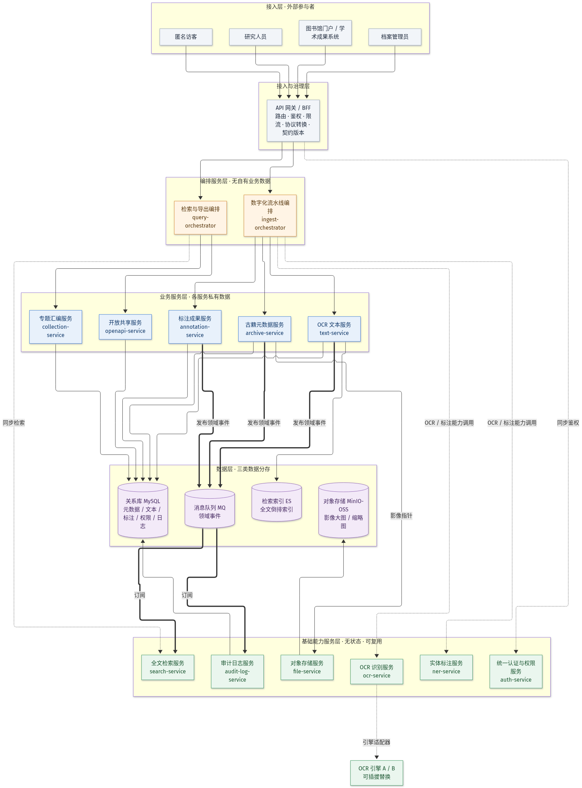
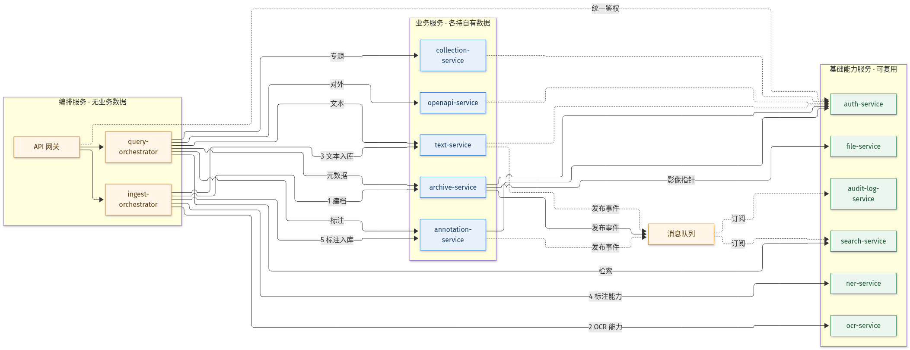
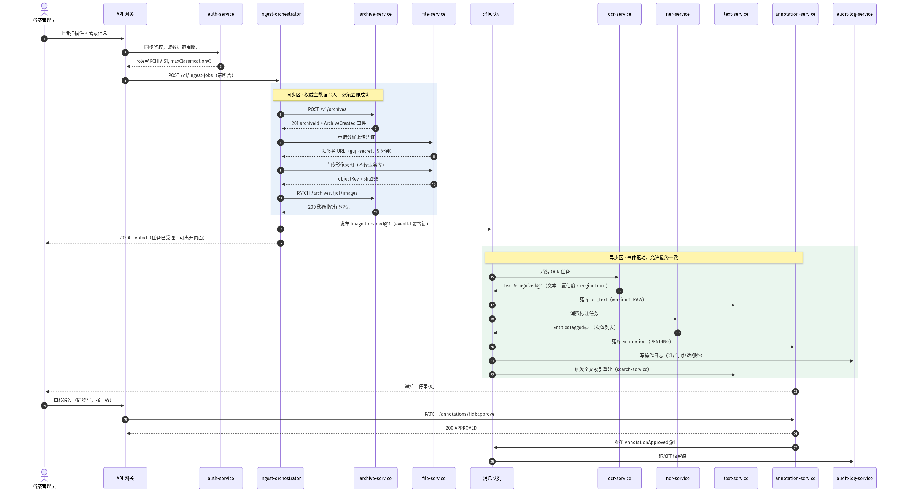
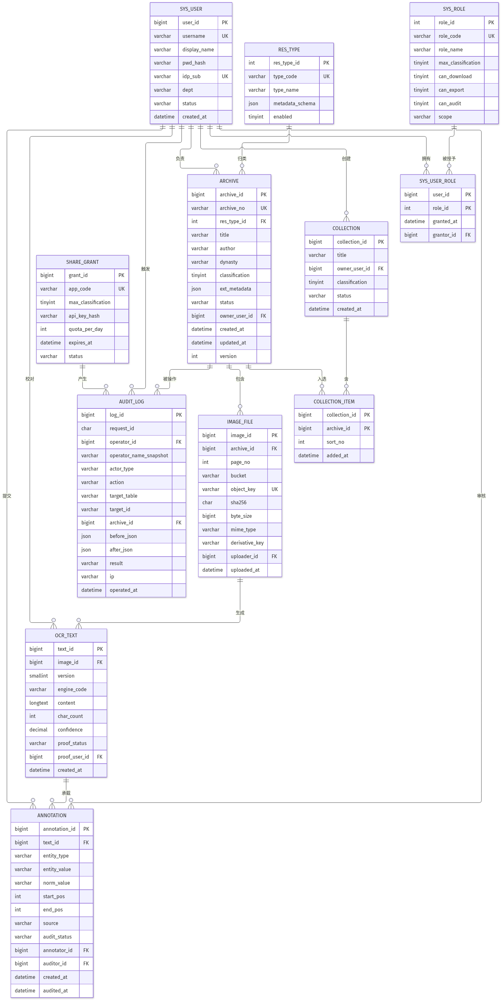
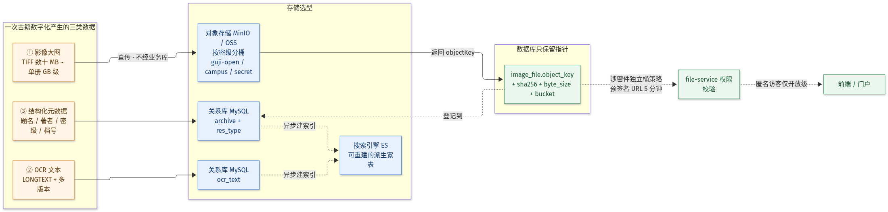
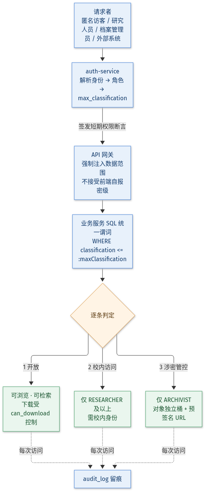

# 面向服务架构（SOA）系统设计 —— 地方古籍文献数字化平台

### 0.1总体分层架构图



> **图 1 · 总体分层架构图**　｜　[在新标签页查看大图](https://raw.githubusercontent.com/kayaksss/ISAD/main/images/1120_fig1.png)


> 图意：五层结构。**上层依赖下层，下层绝不反向依赖上层**；编排层「只编排、不持有业务数据」；业务层「各自持有自己的数据」；能力层「无状态、无业务语义、可被多处复用」。实线为同步调用，粗双线为异步事件，虚线为能力/依赖调用。

---

## 1. 问题 1：面向服务设计

### 1.1 服务边界划分方法

按附录 H.6 的方法：**先从用例与外部请求识别「系统操作（System Operation）」，再把操作分配给服务并定义 API**，而不是按数据库表或页面按钮拆分（教材 ch04：微服务「关键是围绕业务边界拆分，而不是按数据库表或页面按钮拆分」）。

| 从用例识别的系统操作 | 归属服务 | 归属层级判断依据 |
| --- | --- | --- |
| 上传古籍扫描影像、著录元数据、审核标注结果 | `archive-service` / `annotation-service` / `file-service` | 有自有业务数据 → 业务服务 |
| OCR 文本校对、实体标注 | `text-service` / `annotation-service` / `ner-service` | 校对结果要落库 → 业务服务；识别动作本身不落库 → 基础能力 |
| 检索、导出专题数据集、公开浏览 | `query-orchestrator` / `collection-service` / `search-service` | 跨多个服务聚合 → 编排服务 |
| 判断「某人能否看某条古籍」 | `auth-service` | 被所有服务共用、无古籍业务语义 → 基础能力 |
| 学校门户 / 成果系统调用平台数据 | `openapi-service` / `GW` | 对外契约边界 → 业务服务 + 网关 |
| 记录「谁、何时、改了哪条记录」 | `audit-log-service` | 横切关注点、被所有服务复用 → 基础能力 |
| 「上传 → 识别 → 标注 → 审核」整条链路 | `ingest-orchestrator` | 只编排、不落业务数据 → 编排服务 |

**边界划分的三条判据**（对应教材「高内聚」自测）：

1. **能否用一句话说清它负责什么**——例如 `ocr-service`：「给定影像，返回文本与置信度」，一句话说完，是功能内聚。
2. **改一条业务规则，是否只需改一处**——例如更换 OCR 引擎，只改 `ocr-service` 内部的引擎适配器，调用方零改动。
3. **是否避免了「通信内聚」陷阱**——不能因为「访问同一张 `archive` 表」就把著录、检索、导出合并成一个服务；它们业务目的不同，必须拆开。

### 1.2 核心服务清单（三层）

#### 1.2.1 基础能力服务（Capability Services）

> 特征：**无状态、不持有业务数据表、无古籍领域语义、可被多个上层服务复用**；对应教材「可复用：组件像积木可被多处调用」。

| 服务名 | 服务职责（一句话） | 自有数据 | 主要调用方 | 可替换性 |
| --- | --- | --- | --- | --- |
| `auth-service` 统一认证与权限服务 | 校验身份，返回「角色 + 最高可见密级 + 操作权限」的数据范围断言 | 只读 `sys_user` / `sys_role` / `sys_user_role` | 网关、全部业务服务 | 可对接学校统一身份认证（IdP），外部格式用适配器隔离 |
| `ocr-service` OCR 识别服务 | 输入影像引用，输出文本、坐标与置信度 | 无（不落库） | 流水线编排、外部系统、检索服务 | **引擎可插拔**：内部策略/适配器，契约不绑定具体引擎 |
| `ner-service` 实体标注服务 | 输入文本，输出人物/地名/职官/年代实体及位置 | 无（不落库） | 流水线编排、标注服务、外部系统 | 可替换模型，同上 |
| `file-service` 对象存储服务 | 影像上传/下载/预签名 URL、分桶隔离、完整性校验、派生缩略图 | 对象（非关系表） | 元数据服务、网关 | 可换 MinIO / S3 / OSS，`object_key` 契约不变 |
| `search-service` 全文检索服务 | 维护全文倒排索引，提供题名/正文/实体检索 | ES 索引（可由关系库重建的派生数据） | 检索编排、开放共享服务 | 索引可重建，非权威数据源 |
| `audit-log-service` 审计日志服务 | 订阅领域事件，写只插不改的操作日志 | `audit_log`（append-only） | 无（事件订阅） | 异步旁路，故障不影响主流程 |

#### 1.2.2 业务服务（Business Services）

> 特征：**按业务能力拆分、各自负责自己的数据（Database per Service）**、可独立部署与扩容。

| 服务名 | 服务职责 | 自有数据表 | 明确「不做」的事（防职责重叠） |
| --- | --- | --- | --- |
| `archive-service` 古籍元数据服务 | 古籍建档、著录、密级与状态管理、档号唯一性 | `archive`、`res_type` | 不做 OCR、不存影像本体、不做检索排序 |
| `text-service` OCR 文本服务 | OCR 文本多版本存储、人工校对、定稿状态 | `ocr_text` | 不调用 OCR 引擎（识别能力在 `ocr-service`）、不生成标注 |
| `annotation-service` 标注成果服务 | 标注记录的持久化、去重、审核流转 | `annotation` | 不做实体识别（识别能力在 `ner-service`）、不改 OCR 正文 |
| `collection-service` 专题汇编服务 | 专题数据集的组装、版本快照、导出任务 | `collection`、`collection_item` | 不复制古籍元数据，只存 `archive_id` 引用 |
| `openapi-service` 开放共享服务 | 面向图书馆门户 / 成果系统的对外契约、配额、字段脱敏 | `share_grant` | 不直接访问 `archive` 表，必须经 `archive-service` API |

#### 1.2.3 编排服务（Orchestration Services）

> 特征：**只负责流程组织与结果聚合，不持有业务数据、不复制业务规则**；对应教材「低耦合：模块通过少量、明确的数据协作」。

| 服务名 | 服务职责 | 编排的步骤 | 失败处理 |
| --- | --- | --- | --- |
| `api-gateway / BFF` 接入网关 | 路由、鉴权前置、协议转换、契约版本、限流 | 请求 → `auth-service` 鉴权 → 注入数据范围 → 转发 | 401/403 快速失败，不透传后端错误细节 |
| `ingest-orchestrator` 数字化流水线编排 | 一本书从上传到可检索的完整流程 | 建档 → 影像上传 → 触发 OCR → 触发标注 → 提交审核 → 发布索引 | 每步可重试；失败事件入死信队列，支持人工排查 |
| `query-orchestrator` 检索与导出编排 | 跨服务聚合「元数据 + 文本 + 标注 + 影像 URL」 | 鉴权 → 检索 → 按密级逐条过滤 → 聚合 → 组装导出 | 单个下游超时降级为部分结果并显式标注 |

#### 1.2.4 服务分层与调用关系图



> **图 2 · 服务分层与调用关系图**　｜　[在新标签页查看大图](https://raw.githubusercontent.com/kayaksss/ISAD/main/images/1120_fig2.png)


> 图意：`ocr-service` 与 `ner-service` 位于能力层、被编排层直接复用，且**不写任何业务表**；`text-service` / `annotation-service` 才负责「把能力产出的结果落库」。这样「识别能力」与「成果管理」职责不重叠，符合题目约束 3，也符合教材「功能内聚」要求。

#### 1.2.5 职责不重叠与内聚性校验

| 服务 | 内聚类型（教材序列） | 校验结论 |
| --- | --- | --- |
| `ocr-service` | 功能内聚（最强） | 所有代码共同完成「影像→文本」，不含落库、不含权限判断 |
| `ner-service` | 功能内聚 | 所有代码共同完成「文本→实体」，不含审核流程 |
| `archive-service` | 功能内聚 | 围绕「古籍主记录」这一数据抽象，接近教材所称「信息内聚」 |
| `ingest-orchestrator` | 顺序内聚 | 上一步产出是下一步输入，形成处理链；但它**不实现**任何一步的业务规则，因此仍是低耦合编排 |
| `audit-log-service` | 功能内聚 | 只做「日志写入与查询」，不参与业务判定 |
| × 被否决的方案 | 偶然/逻辑内聚 | 曾考虑用一个 `CommonService` 塞下「OCR + 标注 + 日志 + 通知」，用 `type` 参数分支——典型的逻辑内聚 + 控制耦合，已按教材原则拆开 |

### 1.3 接口契约（任选 2 个服务）

> 统一约定：HTTP + JSON；所有响应含 `requestId`（链路追踪）；错误统一为 `{code, message, requestId, details?}`；写接口要求 `Idempotency-Key` 请求头保证幂等；契约通过 `/v1` 路径版本化。

#### 契约一：基础能力服务 —— `ocr-service`

| 项 | 内容 |
| --- | --- |
| **服务名称** | `ocr-service` OCR 识别服务 |
| **服务职责** | 接收影像对象引用，返回识别文本、字符级坐标与置信度；**不写库、不判断权限、不感知古籍业务** |
| **接口** | `POST /v1/ocr:recognize` |

**入参（Request）**

```json
{
  "requestId": "req-20261120-0001",
  "image": {
    "bucket": "guji-campus",
    "objectKey": "archive/2026/2503408007/p001.tif",
    "sha256": "9f86d081884c7d659a2feaa0c55ad015a3bf4f1b2b0b822cd15d6c15b0f00a08"
  },
  "language": "zh-classical",
  "options": {
    "layout": "vertical",
    "withBoxes": true,
    "timeoutMs": 30000
  }
}
```

**出参（Response 200）**

```json
{
  "requestId": "req-20261120-0001",
  "code": "OK",
  "data": {
    "text": "吳郡志卷第一\n蘇州府治……",
    "charCount": 1268,
    "avgConfidence": 0.9312,
    "engineTrace": "ocr-engine-b@v3.2.1",
    "boxes": [
      { "char": "吳", "x": 112, "y": 48, "w": 36, "h": 38, "confidence": 0.9821 }
    ],
    "elapsedMs": 1840
  }
}
```

**异常返回（统一错误体）**

```json
{
  "requestId": "req-20261120-0001",
  "code": "OCR_ENGINE_UNAVAILABLE",
  "message": "识别引擎暂时不可用，请稍后重试",
  "retryable": true,
  "details": { "engine": "ocr-engine-b", "failover": "queued" }
}
```

| 错误码 | HTTP | 含义 | 可重试 |
| --- | --- | --- | --- |
| `INVALID_ARGUMENT` | 400 | `objectKey` 缺失、`sha256` 格式错误、语言不支持 | 否 |
| `OBJECT_NOT_FOUND` | 404 | 对象存储中不存在该影像，或校验和不匹配 | 否 |
| `UNAUTHORIZED` / `FORBIDDEN` | 401 / 403 | 令牌无效 / 无权访问该密级分桶 | 否 |
| `PAYLOAD_TOO_LARGE` | 413 | 单页影像超过大小上限，应改走异步批量接口 | 否 |
| `OCR_TIMEOUT` | 504 | 识别超时 | 是 |
| `OCR_ENGINE_UNAVAILABLE` | 503 | 引擎故障，已自动切换备用引擎或转入队列 | 是 |
| `RATE_LIMITED` | 429 | 超出配额 | 是（退避） |

> **契约设计要点（对应题目约束 5）**：入参中**没有 `engine` 参数**。调用方只声明「要什么」（语言、版式、是否要坐标），不声明「用哪个引擎」；引擎选择由服务内部的策略/适配器决定，`engineTrace` 仅作**溯源输出**。因此更换 OCR 引擎时，API 契约不变，所有调用方零改动——这正是教材「外部耦合可通过适配器隔离外部格式，让业务模块使用内部统一的数据结构」的应用。若把 `engine` 暴露到入参，调用方就必须知道服务内部实现，会退化成**控制耦合 / 外部耦合**。

#### 契约二：业务服务 —— `archive-service`

| 项 | 内容 |
| --- | --- |
| **服务名称** | `archive-service` 古籍元数据服务 |
| **服务职责** | 古籍建档与著录、档号唯一性校验、密级与状态管理；**只负责结构化元数据，不存影像本体、不存 OCR 正文** |
| **接口** | `POST /v1/archives`（另提供 `GET /v1/archives/{id}`、`PATCH /v1/archives/{id}/classification`） |

**入参（Request）**

```json
{
  "requestId": "req-20261120-0002",
  "operatorToken": "<由 auth-service 签发的短期断言>",
  "archive": {
    "archiveNo": "SZ-GJ-2026-0001",
    "resTypeCode": "GUJI",
    "title": "蘇州府志",
    "author": "盧熊",
    "dynasty": "明",
    "pubYearDesc": "洪武十二年",
    "classification": 3,
    "extMetadata": {
      "volumeCount": 50,
      "holdingInstitution": "苏州大学图书馆",
      "sourceNote": "扫描件来自馆藏原本"
    }
  }
}
```

**出参（Response 201）**

```json
{
  "requestId": "req-20261120-0002",
  "code": "CREATED",
  "data": {
    "archiveId": "1000000001",
    "archiveNo": "SZ-GJ-2026-0001",
    "classification": 3,
    "status": "DRAFT",
    "version": 0,
    "createdAt": "2026-11-20T17:39:25.123+08:00"
  },
  "events": ["ArchiveCreated@1"]
}
```

**异常返回**

```json
{
  "requestId": "req-20261120-0002",
  "code": "CLASSIFICATION_FORBIDDEN",
  "message": "当前角色无权创建涉密管控级古籍",
  "retryable": false,
  "details": { "roleMaxClassification": 2, "requested": 3 }
}
```

| 错误码 | HTTP | 含义 | 可重试 |
| --- | --- | --- | --- |
| `INVALID_ARGUMENT` | 400 | 题名为空、`classification` 不在 1/2/3、`extMetadata` 不符合该类型 JSON Schema | 否 |
| `DUPLICATE_ARCHIVE_NO` | 409 | 档号已存在（唯一索引 `uk_archive_no` 兜底） | 否 |
| `UNKNOWN_RES_TYPE` | 422 | `resTypeCode` 未在 `res_type` 字典启用 | 否 |
| `CLASSIFICATION_FORBIDDEN` | 403 | 请求密级超过角色 `max_classification` | 否 |
| `OPERATOR_ASSERT_EXPIRED` | 401 | 权限断言过期，需重新向 `auth-service` 申请 | 否 |
| `VERSION_CONFLICT` | 409 | 乐观锁冲突（并发修改） | 是（重读后重试） |
| `IDEMPOTENT_CONFLICT` | 409 | 同一 `Idempotency-Key` 但请求体不同 | 否 |
| `STORAGE_UNAVAILABLE` | 503 | 元数据库暂不可用 | 是 |

> **契约设计要点**：
> ① **最小 DTO（数据耦合）**——入参只传建档必需字段，不传整份「用户档案」对象，避免教材所说「标记耦合：把整个对象传过去但只需要几个字段」；
> ② **权限不信任调用方**——`classification` 是否合法由服务依据 `auth-service` 签发的断言复核，而不是由前端决定；
> ③ **密级是数据层约束**——写入前校验 `classification <= role.max_classification`，与 §2.5 的行级过滤形成「写 + 读」双侧闭环；
> ④ 成功响应中返回 `events`，表明「建档成功」这一**权威业务结果已由同步事务落库**，事件只是后续旁路的通知，不用来判定交易是否成功（教材 EDA 要点）。

### 1.4 服务之间如何解耦 + 同步 / 异步场景选择

#### 1.4.1 六条解耦机制（含教材耦合类型自查）

| # | 解耦机制 | 具体做法 | 避免的耦合类型 |
| --- | --- | --- | --- |
| 1 | **版本化 API 契约 + API 网关** | 服务间只通过 `/v1` 契约协作；网关承担路由、协议转换、统一治理（教材 SOA 段落）；契约变更前双版本并行 | 内容耦合（不得绕过接口直接改对方内部实现/表） |
| 2 | **Database per Service** | 每个业务服务独占自己的表；`openapi-service` 严禁直连 `archive` 表；跨服务只传 ID | 公共耦合（不共享同一份可写全局数据） |
| 3 | **最小 DTO / 消息契约** | 只传必需字段；跨服务只传 `archiveId`、`imageId` 等标识，不传整对象 | 标记耦合、控制耦合（不用 `mode` 参数让对方走内部分支） |
| 4 | **适配器 + 依赖倒置（DIP / ORM）** | OCR 引擎、对象存储、数据库方言全部经由接口/Repository 隔离；业务层依赖抽象 | 外部耦合（外部格式/协议变化不波及业务模块） |
| 5 | **事件驱动 EDA** | 业务服务发布「发生了什么」，审计/索引/共享服务订阅；发布方不知道订阅方是谁 | 从「数据耦合」进一步趋向「消息耦合」 |
| 6 | **幂等 + 超时 + 熔断 + 重试** | 写接口 `Idempotency-Key`，事件携带 `eventId` 去重；下游故障降级为部分结果 | 分布式调用带来的时序紧耦合 |

**耦合/内聚自查表（严格对照教材 ch04「把耦合看具体」）**

| 教材耦合级别 | 本项目是否出现 | 本设计的处置 |
| --- | --- | --- |
| 内容耦合（最紧） | 无 | 网关不得直接 UPDATE `archive` 表；一切经 `archive-service` API |
| 公共耦合 | 无 | 取消共享 `currentArchiveStatus` 全局缓存；状态由 `archive-service` 独占维护 |
| 外部耦合 | 有风险点 | OCR 引擎报文、MinIO SDK、SQL 方言 → 全部收敛到适配器层 |
| 控制耦合 | 无 | 不设 `POST /common?type=ocr|ner`；每种能力独立接口 |
| 标记耦合 | 无 | 不传完整 `User` / `Archive` 大对象，只传 `archiveId` + 必需字段 |
| 数据耦合（较松） | **主要形态** | 同步 API 之间只传完成任务必需的参数并返回约定结果 |
| 消息耦合（服务场景更松） | **异步通信形态** | 事件只依赖稳定的事件契约，不含对方内部实现细节 |

> 结论：本设计的同步调用落在**数据耦合**，异步协作落在**消息耦合**，均未出现内容/公共/控制耦合；各服务为**功能内聚**。符合题目「不允许紧耦合」「高内聚低耦合」与评分要点。

#### 1.4.2 同步调用 / 消息队列异步调用的场景选择理由

| 场景 | 通信方式 | 选择理由 | 失败处理 |
| --- | --- | --- | --- |
| 登录鉴权、判定「能否看/能否下载这条古籍」 | **同步** HTTP | 权限结论是**后续一切操作的前提**，必须即时、强一致、可据此立即拒绝；教材明确指出资格判断「不能仅靠发出事件就认为交易已成功」 | 快速失败 401/403；`auth-service` 故障时网关默认拒绝（fail-closed） |
| 古籍建档、著录修改、密级变更、标注审核通过 | **同步** + 本地事务 | 属于**权威主数据写入**，要求「提交即生效」且并发受乐观锁控制；结果需立即返回给操作人员 | 409 冲突重读重试；事务回滚不产生事件 |
| 单页即时 OCR 预览（管理员上传后想立刻看效果） | **同步** HTTP | 短耗时（秒级）、用户在线等待结果 | 超时 504 后自动降级为异步任务并提示 |
| 题名/正文检索、按档号查询详情 | **同步** HTTP | 交互式查询要求低延迟与确定性响应 | 下游超时降级为部分结果并显式标注 |
| **整册（数十~数百页）OCR 识别** | **异步** MQ | 耗时长（分钟级）、CPU 密集、需削峰；用户不需在线等待；可单独扩容 OCR Worker | 分片重试；死信队列 + 人工排查 |
| **全册实体标注 / 模型重跑** | **异步** MQ | 批量、可重入、可被其他服务复用触发；允许最终一致 | 以 `eventId` 幂等去重 |
| 全文索引重建、缩略图派生、专题数据集导出 | **异步** MQ | 都是**可由权威数据重建的派生数据**，不应阻塞主流程 | 失败可重放事件重建 |
| 操作留痕写 `audit_log` | **异步** MQ | 横切旁路，审计服务故障不应拖垮著录主流程；「谁、何时、改了哪条」允许秒级延迟落库 | 消息持久化 + 至少一次投递 + 幂等写入 |
| 向图书馆门户 / 成果系统推送共享数据 | **异步** MQ | 外部系统不可控，用队列隔离其抖动；发布方不必知道订阅方 | 退避重试 + 对账补偿 |

**判断口诀**：**「要立刻拿结论才能继续走」→ 同步；「发生了，之后慢慢处理」→ 异步**。权威主数据的写入与权限判定用同步事务保证可靠；派生数据、长耗时任务、旁路通知用事件解耦。这与教材「SOA/微服务/EDA 可组合，不必一次性全部微服务化」以及「事件通常异步处理，因此提醒和报表可能稍后更新」完全一致。

#### 1.4.3 数字化全链路时序图（标注同步 / 异步边界）



> **图 3 · 数字化全链路时序图**　｜　[在新标签页查看大图](https://raw.githubusercontent.com/kayaksss/ISAD/main/images/1120_fig3.png)


> 图意：蓝色区为**同步区**（鉴权、建档、密级、审核——必须有确定结果），绿色区为**异步区**（OCR、标注、索引、日志——可延迟、可重放）。`ocr-service` 与 `ner-service` 只被消费端调用、不直接写业务表，体现「能力复用」；日志走旁路，故障不影响主流程。

#### 1.4.4 领域事件清单

| 事件（版本） | 发布者 | 订阅者 | 幂等键 | 重试 / 兜底 |
| --- | --- | --- | --- | --- |
| `ArchiveCreated@1` | `archive-service` | `audit-log-service`、`openapi-service` | `eventId = archiveId + version` | 至少一次投递；重放不产生重复建档 |
| `ImageUploaded@1` | `file-service` | `ocr-service` Worker、`search-service` | `sha256 + imageId` | 分片重试；死信队列人工排查 |
| `TextRecognized@1` | `ocr-service` | `text-service`、`ner-service` | `imageId + version` | 重复投递按唯一索引 `uk_text_image_version` 去重 |
| `EntitiesTagged@1` | `ner-service` | `annotation-service` | `textId + startPos + entityType` | 按 `uk_anno_span` 去重 |
| `AnnotationApproved@1` | `annotation-service` | `audit-log-service`、`search-service` | `annotationId + auditVersion` | 审核为同步写入，事件仅作通知 |
| `ArchiveExported@1` | `collection-service` | `audit-log-service`、`openapi-service` | `exportTaskId` | 导出任务可重放 |

#### 1.4.5 一致性边界说明

- **强一致边界**：单条古籍主记录、密级、标注审核状态——由单个服务内的本地事务保证，同步返回。
- **最终一致边界**：OCR 文本、标注成果、全文索引、审计日志、对外共享数据——通过事件驱动，秒级~分钟级收敛。
- **可靠性三件套**（教材 EDA 原文要点）：① 消费者能处理**重复投递**（唯一索引 + `eventId` 去重）；② 失败消息**可重试或人工排查**（重试队列 + 死信队列）；③ **不能仅靠「发出事件」就认为交易已成功**——建档/审核的权威结论以同步事务返回为准，事件只触发后续派生工作。
- **发布方无感知扩展**：将来新增「知识图谱构建服务」订阅 `EntitiesTagged@1`，无需改动流水线主流程，这正是「支持后续新增资源类型 / 不紧耦合」的体现。

---

## 2. 问题 2：数据层概念与逻辑模型设计

### 2.1 概念模型（E-R 图）



> **图 4 · 概念模型 E-R 图**　｜　[在新标签页查看大图](https://raw.githubusercontent.com/kayaksss/ISAD/main/images/1120_fig4.png)


> 图例：`PK` 主键、`FK` 外键、`UK` 唯一键；`||--o{` 表示 1:N，`||--o|` 表示 1:0..1。核心链路为 **`ARCHIVE` 1:N `IMAGE_FILE` 1:N `OCR_TEXT` 1:N `ANNOTATION`**，权限与日志从两侧横切。

#### 2.1.1 实体—属性—关系清单（文字版，不依赖渲染）

| 实体 | 含义 | 主键 | 关键属性 | 外键 | 关系与基数 |
| --- | --- | --- | --- | --- | --- |
| `RES_TYPE` 资源类型 | 古籍/地方志/族谱类型字典，扩展点 | `res_type_id` | `type_code`(UK)、`metadata_schema`(JSON) | — | 1 : N → `ARCHIVE` |
| `ARCHIVE` 古籍主表 | 一条古籍的结构化元数据 | `archive_id` | `archive_no`(UK)、`title`、`classification`(1/2/3)、`ext_metadata`(JSON)、`version` | `res_type_id`、`owner_user_id` | N : 1 ← `RES_TYPE`；1 : N → `IMAGE_FILE` / `AUDIT_LOG` / `COLLECTION_ITEM` |
| `IMAGE_FILE` 影像文件 | 一页扫描件的**存储指针**，不存二进制 | `image_id` | `object_key`(UK)、`sha256`、`bucket`、`page_no` | `archive_id`、`uploader_id` | N : 1 ← `ARCHIVE`；1 : N → `OCR_TEXT` |
| `OCR_TEXT` OCR 文本 | 某页某版本的识别/校对文本 | `text_id` | `version`、`engine_code`、`content`(LONGTEXT)、`proof_status` | `image_id`、`proof_user_id` | N : 1 ← `IMAGE_FILE`；1 : N → `ANNOTATION`；UK(`image_id`,`version`) |
| `ANNOTATION` 标注记录 | 一个实体标注（人物/地名/职官/年代） | `annotation_id` | `entity_type`、`entity_value`、`start_pos/end_pos`、`audit_status` | `text_id`、`annotator_id`、`auditor_id` | N : 1 ← `OCR_TEXT` / `SYS_USER` |
| `SYS_USER` 用户 | 平台账号（匿名访客不建账号） | `user_id` | `username`(UK)、`idp_sub`(UK)、`status` | — | M : N ↔ `SYS_ROLE`（经 `SYS_USER_ROLE`） |
| `SYS_ROLE` 角色权限 | 密级与操作权限的载体 | `role_id` | `role_code`(UK)、`max_classification`、`can_download/export/audit` | — | 1 : N → `SYS_USER_ROLE` |
| `SYS_USER_ROLE` 用户角色关联 | 消解 M:N 的关联实体 | (`user_id`,`role_id`) 复合主键 | `granted_at`、`grantor_id` | `user_id`、`role_id` | — |
| `AUDIT_LOG` 操作日志 | 谁、何时、改了哪条记录 | `log_id` | `operator_name_snapshot`、`action`、`target_table/target_id`、`before_json/after_json`、`operated_at` | `operator_id`、`archive_id`（日志侧弱引用） | N : 1 ← `SYS_USER` / `ARCHIVE` |
| `COLLECTION` / `COLLECTION_ITEM` 专题汇编 | 专题数据集及其成员 | `collection_id` / 复合主键 | `title`、`sort_no` | `owner_user_id`、`archive_id` | M:N 经 `COLLECTION_ITEM` 消解 |
| `SHARE_GRANT` 共享授权 | 图书馆门户 / 成果系统的对外授权 | `grant_id` | `app_code`(UK)、`max_classification`、`quota_per_day` | — | 约束 `openapi-service` 的对外数据范围 |

### 2.2 规范化（范式）说明 —— 附录 H.7

| 范式 | 要求 | 本设计的落实 |
| --- | --- | --- |
| **1NF 原子性** | 每个属性不可再分、无重复组 | 不在 `archive` 里塞 `tag1,tag2,tag3` 或把多页影像拼成一个字段；影像、标注各自独立成行；`ext_metadata` 虽为 JSON，但它是**类型可扩展的半结构化扩展位**，不作为检索与连接键，不破坏关系模式的原子性 |
| **2NF 完全函数依赖** | 非主属性完全依赖整个主键 | `annotation` 里不重复存 `title`、`username`；`collection_item` 的复合主键 (`collection_id`,`archive_id`) 上只放 `sort_no`、`added_at` 等完全依赖属性，不放入古籍题名 |
| **3NF 无传递依赖** | 非主属性不依赖于其他非主属性 | `archive` 只存 `res_type_id` 而不存类型名称；`ocr_text` **不冗余 `archive_id`**（可由 `image_id` 传递得到），避免传递依赖；`audit_log` 存 `operator_id` 而非用户部门等派生信息 |

**受控冗余（有意为之，且不破坏范式目标）**

| 冗余字段 | 位置 | 理由 |
| --- | --- | --- |
| `operator_name_snapshot` | `audit_log` | **快照语义**：用户改名/离职/删除后，审计记录仍须还原「当时是谁」，属于不可变的历史快照，不是可更新的业务副本 |
| `char_count` | `ocr_text` | 避免在 LONGTEXT 上反复计算；由写入时一次生成，不可变 |
| `archive_id` | `audit_log` | 日志侧弱引用，便于按古籍聚合查询；日志表为 append-only，不参与业务一致性 |
| 宽表索引 | ES（**关系库之外**） | 全文检索需要把 `title + content + entity_value` 拉平成宽表；冗余只放在**可重建的派生索引**里，关系库仍保持 3NF |

> 说明：教材 H.7 指出「关系模型与范式：1NF/2NF/3NF，实体与联系用二维表表达」，并给出「ORM / JPA：对象↔关系表的自动映射」。本设计的关系库严格保持 3NF，把必要的检索冗余外移到搜索引擎，属于标准的「关系库管权威数据、索引库管派生视图」分工。

### 2.3 核心数据表设计

> 采用 MySQL 8.0 类型；`DATETIME(3)` 保留毫秒；所有表统一 `utf8mb4`；主键用无符号 BIGINT 自增（业务主键另设唯一码）。`PK / FK / UK / NN / IDX` 分别表示主键、外键、唯一键、非空、索引。

#### 表 1 `res_type` 资源类型表（扩展点）

| 字段 | 类型 | 约束 | 说明 |
| --- | --- | --- | --- |
| `res_type_id` | `INT UNSIGNED` | **PK**, AUTO_INCREMENT, NN | 类型 ID |
| `type_code` | `VARCHAR(32)` | **UK** `uk_type_code`, NN | `GUJI` / `DFZ` / `ZP` |
| `type_name` | `VARCHAR(64)` | NN | 古籍 / 地方志 / 族谱 |
| `metadata_schema` | `JSON` | NULL | 该类型扩展元数据的 JSON Schema |
| `enabled` | `TINYINT(1)` | NN DEFAULT 1 | 是否启用 |
| `created_at` | `DATETIME(3)` | NN DEFAULT CURRENT_TIMESTAMP(3) | 创建时间 |

#### 表 2 `archive` 古籍主表 ⭐

| 字段 | 类型 | 约束 | 说明 |
| --- | --- | --- | --- |
| `archive_id` | `BIGINT UNSIGNED` | **PK**, AUTO_INCREMENT, NN | 内部主键 |
| `archive_no` | `VARCHAR(64)` | **UK** `uk_archive_no`, NN | 业务档号，唯一 |
| `res_type_id` | `INT UNSIGNED` | **FK** → `res_type.res_type_id`, NN | 资源类型 |
| `title` | `VARCHAR(255)` | NN | 题名 |
| `author` | `VARCHAR(128)` | NULL | 著者 |
| `dynasty` | `VARCHAR(32)` | NULL | 朝代 |
| `pub_year_desc` | `VARCHAR(64)` | NULL | 年代描述（古籍年代多模糊，不用数值型） |
| `classification` | `TINYINT` | NN DEFAULT 3, `CHECK (classification IN (1,2,3))` | **1 开放 / 2 校内 / 3 涉密管控** |
| `ext_metadata` | `JSON` | NULL | 按 `res_type` 的扩展字段，新增资源类型不改表 |
| `status` | `VARCHAR(16)` | NN DEFAULT `'DRAFT'` | `DRAFT` / `ACTIVE` / `ARCHIVED` |
| `owner_user_id` | `BIGINT UNSIGNED` | **FK** → `sys_user.user_id`, NN | 责任馆员 |
| `created_at` / `updated_at` | `DATETIME(3)` | NN | 时间戳 |
| `version` | `INT` | NN DEFAULT 0 | 乐观锁，防并发覆盖 |

**索引**：`uk_archive_no`(UNIQUE)、`idx_archive_filter(res_type_id, classification, status)`（按类型+密级筛选，贴合三类权限过滤）、`idx_archive_dynasty(dynasty, created_at)`（按朝代浏览）、`FULLTEXT ft_archive_title(title, author) WITH PARSER ngram`（中文题名/著者检索）。

#### 表 3 `image_file` 影像文件表 ⭐（只存指针，不存 BLOB）

| 字段 | 类型 | 约束 | 说明 |
| --- | --- | --- | --- |
| `image_id` | `BIGINT UNSIGNED` | **PK**, AUTO_INCREMENT, NN | 影像 ID |
| `archive_id` | `BIGINT UNSIGNED` | **FK** → `archive.archive_id`, NN | 所属古籍 |
| `page_no` | `INT` | NN | 页序 |
| `bucket` | `VARCHAR(64)` | NN | 分桶：`guji-open` / `guji-campus` / `guji-secret` |
| `object_key` | `VARCHAR(512)` | **UK** `uk_object_key`, NN | **对象存储键（文件本体不入库）** |
| `sha256` | `CHAR(64)` | NN | 完整性校验 + 秒传去重 |
| `byte_size` | `BIGINT UNSIGNED` | NN | 字节数 |
| `mime_type` | `VARCHAR(64)` | NN | `image/tiff` 等 |
| `width` / `height` | `INT` | NULL | 像素尺寸 |
| `derivative_key` | `VARCHAR(512)` | NULL | 缩略图 / JPEG 派生件键 |
| `uploader_id` | `BIGINT UNSIGNED` | **FK** → `sys_user.user_id`, NN | 上传人 |
| `uploaded_at` | `DATETIME(3)` | NN | 上传时间 |

**索引**：`uk_object_key`(UNIQUE)、`uk_image_page(archive_id, page_no)`(UNIQUE，防重复页)、`idx_image_sha256(sha256)`（去重/校验）、`idx_image_archive(archive_id, uploaded_at)`（按古籍拉取页序列表）。

#### 表 4 `ocr_text` OCR 文本表 ⭐

| 字段 | 类型 | 约束 | 说明 |
| --- | --- | --- | --- |
| `text_id` | `BIGINT UNSIGNED` | **PK**, AUTO_INCREMENT, NN | 文本 ID |
| `image_id` | `BIGINT UNSIGNED` | **FK** → `image_file.image_id`, NN | 来源影像 |
| `version` | `SMALLINT` | NN DEFAULT 1 | 同页多版本（重识别 / 校对） |
| `engine_code` | `VARCHAR(32)` | NN | 所用引擎**溯源记录**，非契约绑定 |
| `content` | `LONGTEXT` | NN | 识别/校对后正文 |
| `char_count` | `INT` | NN | 派生统计（受控冗余） |
| `confidence` | `DECIMAL(5,4)` | NULL | 平均置信度 |
| `proof_status` | `VARCHAR(16)` | NN DEFAULT `'RAW'` | `RAW` / `PROOFING` / `APPROVED` |
| `proof_user_id` | `BIGINT UNSIGNED` | **FK** → `sys_user.user_id`, NULL | 校对人 |
| `created_at` | `DATETIME(3)` | NN | 生成时间 |

**索引**：`uk_text_image_version(image_id, version)`(UNIQUE，事件重复投递幂等)、`FULLTEXT ft_ocr_content(content) WITH PARSER ngram`（古籍全文检索）、`idx_text_status(proof_status, created_at)`（待校对队列）。
> 注：**不冗余 `archive_id`**，以保持 3NF；按古籍检索正文时，由 `search-service` 的 ES 宽表冗余该字段，关系库不承担检索冗余。

#### 表 5 `annotation` 标注记录表 ⭐

| 字段 | 类型 | 约束 | 说明 |
| --- | --- | --- | --- |
| `annotation_id` | `BIGINT UNSIGNED` | **PK**, AUTO_INCREMENT, NN | 标注 ID |
| `text_id` | `BIGINT UNSIGNED` | **FK** → `ocr_text.text_id`, NN | 所属文本版本 |
| `entity_type` | `VARCHAR(24)` | NN | `PERSON` / `PLACE` / `OFFICIAL` / `TIME` |
| `entity_value` | `VARCHAR(255)` | NN | 实体字面值（如「盧熊」「吳郡」） |
| `norm_value` | `VARCHAR(255)` | NULL | 规范名（对接人物/地名词典） |
| `start_pos` / `end_pos` | `INT` | NN | 在 `content` 中的字符偏移 |
| `confidence` | `DECIMAL(5,4)` | NULL | 模型置信度 |
| `source` | `VARCHAR(16)` | NN | `AUTO` / `MANUAL` |
| `audit_status` | `VARCHAR(16)` | NN DEFAULT `'PENDING'` | `PENDING` / `APPROVED` / `REJECTED` |
| `annotator_id` | `BIGINT UNSIGNED` | **FK** → `sys_user.user_id`, NN | 标注人 |
| `auditor_id` | `BIGINT UNSIGNED` | **FK** → `sys_user.user_id`, NULL | 审核人 |
| `created_at` / `audited_at` | `DATETIME(3)` | NN / NULL | 时间戳 |

**索引**：`uk_anno_span(text_id, start_pos, end_pos, entity_type)`(UNIQUE，防同一位置重复标注)、`idx_anno_text(text_id, entity_type)`（按文本取全部标注）、`idx_anno_audit(audit_status, created_at)`（待审核队列）、`idx_anno_entity(entity_type, entity_value(64))`（按人名/地名检索，前缀索引）。

#### 表 6 `sys_user` 用户表 ⭐（用户权限表组 1/3）

| 字段 | 类型 | 约束 | 说明 |
| --- | --- | --- | --- |
| `user_id` | `BIGINT UNSIGNED` | **PK**, AUTO_INCREMENT, NN | 用户 ID |
| `username` | `VARCHAR(64)` | **UK** `uk_user_username`, NN | 登录名 |
| `display_name` | `VARCHAR(64)` | NN | 显示名 |
| `pwd_hash` | `VARCHAR(255)` | NN | 密码散列（不存明文） |
| `idp_sub` | `VARCHAR(128)` | **UK** `uk_idp_sub`, NULL | 学校统一身份认证的 subject |
| `dept` | `VARCHAR(128)` | NULL | 所属部门 |
| `status` | `VARCHAR(16)` | NN DEFAULT `'ACTIVE'` | `ACTIVE` / `DISABLED` |
| `created_at` | `DATETIME(3)` | NN | 创建时间 |

**索引**：`uk_user_username`、`uk_idp_sub`、`idx_user_status(status, created_at)`。

#### 表 7 `sys_role` 角色权限表 ⭐（用户权限表组 2/3）

| 字段 | 类型 | 约束 | 说明 |
| --- | --- | --- | --- |
| `role_id` | `INT UNSIGNED` | **PK**, AUTO_INCREMENT, NN | 角色 ID |
| `role_code` | `VARCHAR(32)` | **UK** `uk_role_code`, NN | `ANON` / `RESEARCHER` / `ARCHIVIST` / `ADMIN` / `EXT_SYSTEM` |
| `role_name` | `VARCHAR(64)` | NN | 角色名 |
| `max_classification` | `TINYINT` | NN, `CHECK (1..3)` | **可見最高密级**：匿名=1，研究人员=2，档案管理员=3 |
| `can_download` | `TINYINT(1)` | NN DEFAULT 0 | 是否可下载影像 |
| `can_export` | `TINYINT(1)` | NN DEFAULT 0 | 是否可导出专题数据集 |
| `can_audit` | `TINYINT(1)` | NN DEFAULT 0 | 是否可审核标注 |
| `scope` | `VARCHAR(32)` | NN DEFAULT `'SELF'` | 数据范围 `SELF` / `DEPT` / `ALL` |

**预置数据**：`ANON(1, 下载=0, 导出=0)`、`RESEARCHER(2, 下载=0, 导出=1)`、`ARCHIVIST(3, 下载=1, 导出=1, 审核=1)`、`EXT_SYSTEM(1, 下载=0, 导出=1)`。

#### 表 8 `sys_user_role` 用户角色关联表 ⭐（用户权限表组 3/3）

| 字段 | 类型 | 约束 | 说明 |
| --- | --- | --- | --- |
| `user_id` | `BIGINT UNSIGNED` | **PK**（复合）, **FK** → `sys_user.user_id`, NN | 用户 |
| `role_id` | `INT UNSIGNED` | **PK**（复合）, **FK** → `sys_role.role_id`, NN | 角色 |
| `granted_at` | `DATETIME(3)` | NN | 授权时间 |
| `grantor_id` | `BIGINT UNSIGNED` | **FK** → `sys_user.user_id`, NN | 授权人 |

**索引**：主键即聚簇索引 (`user_id`,`role_id`)；附加 `idx_role_user(role_id, user_id)` 支持按角色反查成员。
> M:N 关系必须经此关联实体消解，否则把多个角色塞进 `sys_user` 的逗号字符串会破坏 1NF。

#### 表 9 `audit_log` 操作日志表 ⭐（append-only）

| 字段 | 类型 | 约束 | 说明 |
| --- | --- | --- | --- |
| `log_id` | `BIGINT UNSIGNED` | **PK**, AUTO_INCREMENT, NN | 日志 ID |
| `request_id` | `CHAR(32)` | NN, **IDX** | 链路追踪，串联一次请求的全部日志 |
| `operator_id` | `BIGINT UNSIGNED` | **FK** → `sys_user.user_id`, NULL | 操作者（匿名/系统为 NULL） |
| `operator_name_snapshot` | `VARCHAR(64)` | NN | **操作者姓名快照**，用户变更后仍可追溯 |
| `actor_type` | `VARCHAR(16)` | NN | `USER` / `ANON` / `SYSTEM` / `EXT_APP` |
| `action` | `VARCHAR(32)` | NN | `CREATE` / `UPDATE` / `DELETE` / `AUDIT` / `EXPORT` / `DOWNLOAD` / `VIEW` |
| `target_table` | `VARCHAR(64)` | NN | 被改的表 |
| `target_id` | `VARCHAR(64)` | NN | **被改的具体记录 ID** |
| `archive_id` | `BIGINT UNSIGNED` | NULL（日志侧弱引用） | 便于按古籍聚合追溯 |
| `before_json` / `after_json` | `JSON` | NULL | **变更前 / 变更后关键字段** |
| `result` | `VARCHAR(16)` | NN | `SUCCESS` / `FAIL` |
| `fail_reason` | `VARCHAR(255)` | NULL | 失败原因 |
| `ip` | `VARCHAR(45)` | NULL | IPv4/IPv6 兼容 |
| `user_agent` | `VARCHAR(255)` | NULL | 客户端 |
| `operated_at` | `DATETIME(3)` | NN | **何时** |

**索引**：`idx_log_archive_time(archive_id, operated_at DESC)`（按古籍查修改史，直接对应题目「改了哪条古籍记录」）、`idx_log_operator_time(operator_id, operated_at DESC)`（按人查操作史）、`idx_log_target(target_table, target_id)`、`idx_log_action_time(action, operated_at)`、`idx_log_request(request_id)`。
**物理设计**：按 `operated_at` 做 **RANGE 月分区**；数据库账号只授予 `INSERT / SELECT`，**不授予 UPDATE / DELETE**，从存储层保证留痕不可篡改。

#### 表 10 `share_grant` 对外共享授权表（补充，支撑上层系统对接）

| 字段 | 类型 | 约束 | 说明 |
| --- | --- | --- | --- |
| `grant_id` | `BIGINT UNSIGNED` | **PK**, AUTO_INCREMENT, NN | 授权 ID |
| `app_code` | `VARCHAR(64)` | **UK** `uk_app_code`, NN | 图书馆门户 / 学术成果系统 |
| `max_classification` | `TINYINT` | NN DEFAULT 1 | 对外默认仅开放级 |
| `api_key_hash` | `VARCHAR(255)` | NN | 密钥散列 |
| `quota_per_day` | `INT` | NN DEFAULT 1000 | 日调用配额 |
| `expires_at` | `DATETIME(3)` | NULL | 授权到期 |
| `status` | `VARCHAR(16)` | NN | `ACTIVE` / `REVOKED` |

#### 表 11 `collection` / `collection_item` 专题汇编表（补充）

| 表 | 字段与约束 |
| --- | --- |
| `collection` | `collection_id` BIGINT UNSIGNED **PK**；`title` VARCHAR(255) NN；`owner_user_id` BIGINT UNSIGNED **FK**→`sys_user` NN；`classification` TINYINT NN（专题继承成员最高密级）；`status` VARCHAR(16) NN；`created_at` DATETIME(3) NN；**IDX** `idx_collection_owner(owner_user_id, created_at)` |
| `collection_item` | `collection_id` BIGINT UNSIGNED **PK/FK**→`collection`；`archive_id` BIGINT UNSIGNED **PK/FK**→`archive`；`sort_no` INT NN；`added_at` DATETIME(3) NN；**UK** 复合主键 (`collection_id`,`archive_id`)；**IDX** `idx_item_archive(archive_id)` |

#### 2.3.1 索引设计 ↔ 检索需求对照（评分要点）

| 检索 / 业务需求 | 使用的索引 | 设计理由 |
| --- | --- | --- |
| 按题名、著者查古籍 | `ft_archive_title` FULLTEXT + ngram | 中文无空格分词，用 ngram 解析器 |
| 匿名访客只看到开放级 | `idx_archive_filter(res_type_id, classification, status)` | 密级过滤是**所有查询的必备谓词**，放入组合索引首屏过滤 |
| OCR 正文全文检索 | `ft_ocr_content` FULLTEXT + ngram | 直接支撑「文献检索」用例 |
| 按人物 / 地名查标注 | `idx_anno_entity(entity_type, entity_value(64))` | 实体字面值较长，用前缀索引省空间 |
| 待校对 / 待审核工作台 | `idx_text_status`、`idx_anno_audit` | 状态 + 时间的列表查询，避免全表扫描 |
| 按档号精确查重 | `uk_archive_no` | 唯一约束兼作查询索引 |
| 影像秒传 / 完整性校验 | `idx_image_sha256` | 重复上传直接复用对象 |
| 「这条古籍被谁改过、何时改的」 | `idx_log_archive_time(archive_id, operated_at DESC)` | 题目约束 4 的核心查询，倒序取最新 |
| 事件重复投递幂等 | `uk_text_image_version`、`uk_anno_span` | 唯一索引在存储层兜底幂等 |

### 2.4 三类数据分开存储 & 影像文件为什么不直接存入数据库表

#### 2.4.1 三类数据的分存路径



> **图 5 · 三类数据分存与影像不入库**　｜　[在新标签页查看大图](https://raw.githubusercontent.com/kayaksss/ISAD/main/images/1120_fig5.png)


> 图意：影像本体**只走对象存储**，关系库只保存 `object_key` 等指针；OCR 文本与结构化元数据分别落在两张表；ES 宽表只是可重建的检索派生视图。三条路径彼此独立，替换任一存储不影响另外两条。

| 数据类别 | 存储位置 | 对应服务 | 库中是否存本体 |
| --- | --- | --- | --- |
| ① 古籍影像大图 | 对象存储（按密级分桶） | `file-service` | **否**，只存 `object_key` / `sha256` / `bucket` |
| ② OCR 文本 | MySQL `ocr_text`（LONGTEXT）+ ES 全文索引 | `text-service` / `search-service` | 是（文本本身是可检索的结构化数据） |
| ③ 结构化元数据 | MySQL `archive` / `res_type` | `archive-service` | 是 |

#### 2.4.2 为什么古籍影像文件不直接存入数据库表（不用 BLOB / LONGBLOB）

**结论先行**：影像是**大体积、不可索引、需独立权限与弹性扩展的二进制对象**，数据库表擅长的是**小体积、可索引、需事务与关联的结构化记录**；二者访问特征完全不同，硬塞进 BLOB 会把数据库的短板暴露在系统的主链路上。

| # | 理由 | 具体机制与后果 |
| --- | --- | --- |
| 1 | **体积与 I/O 性能** | 单页无损 TIFF 常达数十 MB，一册数百页可达 GB 级。BLOB 会造成行溢出、缓冲池被大对象挤占、全表扫描与 `SELECT *` 被严重拖慢，连带拖累本应很快的元数据查询；备份、恢复、DDL、主从复制时间成倍增长 |
| 2 | **检索无任何收益** | BLOB 不能建立有意义的索引、不能参与 `WHERE` / `JOIN` / 排序。用户检索靠的是题名、著者、OCR 正文（§2.3 的 FULLTEXT 索引），把影像放库里对检索零帮助，只增加负担 |
| 3 | **数据库扩容昂贵，对象存储可水平扩展** | 影像是增长最快的部分。对象存储天然支持分片、CDN 加速、断点续传、分片直传、预签名 URL、按需派生缩略图；这些能力数据库都不提供，靠库扩容成本极高 |
| 4 | **权限隔离与安全** | 题目约束 2 要求三类密级隔离。对象存储可按桶配置独立 IAM 策略、服务端加密、访问审计、短时效预签名 URL、水印派生件；若放库里，只要能查到该行就可能拿到整块二进制，难以做对象级隔离与「匿名不可下载涉密件」的强制约束 |
| 5 | **连接与事务资源** | 大文件传输会长时间占用数据库连接与事务，阻塞其他用户的著录/检索；对象存储直传把这条重 I/O 完全移出数据库链路 |
| 6 | **不留耦合、可替换（约束 5）** | `object_key` 是稳定契约：换 MinIO→S3、换 MySQL→PostgreSQL 互不影响。若把二进制写进表，存储格式与数据库强绑定，迁移要搬整个库。对应教材「外部耦合：可通过适配器隔离外部格式，让业务模块使用内部统一的数据结构」，以及附录 H.7 的 **NoSQL 四类**（键值/文档/列族/图）中「键值/对象存储」承担大对象的思路 |
| 7 | **符合三类数据分存约束（约束 1）** | 影像、OCR 文本、元数据若同放一表，会形成「一行里既有 GB 级 BLOB 又有 LONGTEXT 又有十几个元数据列」的宽表，违反 1NF 精神、无法独立扩容、无法独立备份 |

**一致性如何保证**（避免「只传了对象没登记」或反之）：

1. `file-service` 先接收并落对象 → 返回 `objectKey`；
2. `archive-service` 在**本地事务**内写入 `image_file` 指针行；
3. 若第 2 步失败，由补偿任务扫描并删除「有对象无记录」的孤儿对象；若对象缺失，指针行的 `sha256` 校验会失败并触发告警；
4. 对象存储是**幂等**的（同 `objectKey` 覆盖写结果一致），因此整体可用「至少一次 + 补偿」达成最终一致，不必引入昂贵的分布式事务。

**「可更换数据库」的落法（约束 5 · 附录 H.7 ORM/JPA）**：业务层只依赖 `ArchiveRepository` / `ImageFileRepository` 等接口，由 ORM 完成对象↔关系表映射；分页、方言、全文索引语法等差异封装在适配器实现中。换库时替换适配器 + 迁移脚本，服务代码与 API 契约不变。

### 2.5 权限隔离与操作留痕的落表实现

#### 2.5.1 三类密级的读写双侧闭环



> **图 6 · 三类密级读写双侧闭环**　｜　[在新标签页查看大图](https://raw.githubusercontent.com/kayaksss/ISAD/main/images/1120_fig6.png)


- **读侧**：所有查询统一追加 `classification <= :maxClassification`，由 `auth-service` 断言注入，前端不可自报；`query-orchestrator` 聚合时再次逐条过滤，防止某个下游漏过滤导致越权。
- **写侧**：`archive-service` 建档 / 改密级时复核 `requestedClassification <= role.max_classification`，否则返回 `CLASSIFICATION_FORBIDDEN`（见契约二）。
- **下载侧**：`file-service` 按密级分桶，涉密桶不生成公网 URL，只签 5 分钟预签名；`ANON` 角色 `can_download = 0`，从角色权限层直接禁止，满足「匿名访客不可下载涉密 / 未开放文献」。
- **对外侧**：`share_grant.max_classification` 默认 1，`openapi-service` 还需做字段脱敏与配额限制。

> 这直接落实附录 H.8「安全、隐私等非功能即隐性需求，应在**设计阶段**就列为架构约束，而非上线后补」。

#### 2.5.2 操作留痕（谁 / 何时 / 改哪条）

| 题目要素 | 落地字段 | 说明 |
| --- | --- | --- |
| **谁** | `operator_id` + `operator_name_snapshot` + `actor_type` | 用户 / 匿名 / 系统 / 外部应用四类主体；姓名快照保证账号变更后仍可追溯 |
| **何时** | `operated_at DATETIME(3)` | 毫秒精度 |
| **改了哪条古籍记录** | `archive_id` + `target_table` + `target_id` | 精确到第几张表、哪一行 |
| **改了什么** | `before_json` / `after_json` | 只记变更字段，避免日志膨胀 |
| **结果与来源** | `result` / `fail_reason` / `ip` / `user_agent` / `request_id` | 失败的越权尝试同样留痕 |

一条示例日志：

```json
{
  "logId": 900001,
  "requestId": "req-20261120-0002",
  "operatorId": 10086,
  "operatorNameSnapshot": "王小予",
  "actorType": "USER",
  "action": "UPDATE",
  "targetTable": "archive",
  "targetId": "1000000001",
  "archiveId": 1000000001,
  "beforeJson": { "classification": 3, "status": "DRAFT" },
  "afterJson":  { "classification": 2, "status": "ACTIVE" },
  "result": "SUCCESS",
  "ip": "202.195.128.7",
  "operatedAt": "2026-11-20T17:39:25.123+08:00"
}
```

> 日志由 `audit-log-service` **异步订阅**领域事件写入（§1.4.2），主流程不受其故障影响；表本身 append-only 且无 UPDATE/DELETE 权限，保证留痕不可抵赖。

### 2.6 扩展性：新增地方志、族谱等资源类型

题目明确「平台不要求一次性全部重构，支持后续新增地方志、族谱等资源类型」。做法对应教材「微服务按业务边界独立演进」「若学校已有很多旧系统，也可以先以 SOA/API 整合，不必一次性全部微服务化」：

| 变化点 | 是否需要改表 | 是否需要改服务 | 做法 |
| --- | --- | --- | --- |
| 新增资源类型 | **否** | **否** | 向 `res_type` 插入一行 `DFZ` / `ZP` 及其 `metadata_schema` |
| 该类型特有的著录字段（卷数、纂修者、堂号等） | **否** | **否** | 写入 `archive.ext_metadata` JSON，由对应 Schema 校验 |
| 该类型特有的著录表单 | **否** | 仅前端 | 按 `metadata_schema` 动态渲染表单 |
| 该类型特有的识别/标注规则 | **否** | 仅能力服务内部策略 | `ocr-service` / `ner-service` 按 `resTypeCode` 选择策略（新增策略实现，不改契约） |
| 完全独立的业务流程 | 视情况 | 新增一个业务服务 | 复用现有基础能力层，通过事件接入，不改既有服务 |

---

## 3. 设计自查（对照评分要点与业务约束）

### 3.1 评分要点核对

| 评分要点 | 落实证据 |
| --- | --- |
| **服务高内聚低耦合** | §1.2.5 内聚类型逐服务判定（均为功能内聚）；§1.4.1 耦合自查表（同步=数据耦合、异步=消息耦合，无内容/公共/控制耦合） |
| **可复用** | `ocr-service` / `ner-service` / `auth-service` / `file-service` 位于能力层，无状态、无业务语义，被编排层、业务层、外部系统多处复用 |
| **职责不重叠** | §1.2.2 每个业务服务明确列出「不做」的事；「识别能力」与「成果落库」分离；`ocr-service` 不写表、`text-service` 不调引擎 |
| **接口契约清晰** | §1.3 两个服务均给出服务名/职责/入参/出参/异常返回 JSON + 完整错误码表 + 幂等与版本约定 |
| **同步 / 异步场景判断合理** | §1.4.2 九类场景逐条给理由；§1.4.3 时序图标出同步区/异步区；§1.4.5 明确强一致与最终一致边界 |
| **实体识别完整、关系合理** | §2.1 十一个实体 + Mermaid E-R 图 + 文字版清单；核心链 `ARCHIVE→IMAGE_FILE→OCR_TEXT→ANNOTATION`，M:N 经关联实体消解 |
| **范式规范（避免大量冗余）** | §2.2 逐条 1NF/2NF/3NF 论证，列出 4 项「受控冗余」并说明理由，检索冗余外移到 ES |
| **索引设计贴合检索需求** | §2.3 每张表列索引；§2.3.1 用「检索需求 → 索引」对照表逐项解释 |

### 3.2 业务约束核对（逐条闭环）

| 约束 | 是否闭环 | 关键位置 |
| --- | --- | --- |
| 1 三类数据分开存储 | ✅ | §2.4.1 分存路径图与对照表 |
| 2 三类权限隔离 | ✅ | §2.5.1 读写双侧闭环 + `classification` + `max_classification` + 分桶 |
| 3 OCR / 实体标注独立可复用 | ✅ | §1.2.1 能力层 + §1.2.4 调用关系图 |
| 4 操作留痕 | ✅ | 表 9 `audit_log` + §2.5.2 要素映射 + 示例 JSON |
| 5 不紧耦合（可换引擎 / 可换库） | ✅ | 契约一「入参不含 engine」+ 适配器 + ORM Repository 接口（§2.4 末） |
| 6 支持新增资源类型 | ✅ | §2.6 扩展点表（`res_type` + `ext_metadata`） |

### 3.3 遗留取舍说明（诚实标注边界）

- 本平台规模为「校级研究中心 + 少量并发」，按教材「系统小、团队少，先用清晰的模块化单体通常更简单」的提示，**当前采用「模块化 SOA + 少量异步事件」而非全面微服务**：服务按业务边界划分并可独立部署，但共享一套关系库实例（逻辑上按服务私有 schema 隔离），待访问量与团队扩大后再物理拆分数据库。这样既满足题目「面向服务设计」要求，也避免过度设计带来的分布式复杂度。
- 密级行级过滤在超大并发下可进一步改为数据库视图 / RLS，本作业按应用层统一谓词实现，属于**建议核实**的工程选型，具体以学校信息安全规范为准。
- 涉及涉密文献的管理制度、对外共享合同条款与数据合规要求，须以学校正式文件为准，本文仅为方法层面的设计参考。

---

## 4. 教材依据与参考

| 编号 | 来源 | 引用内容 |
| --- | --- | --- |
| [1] | 《信息系统分析与设计》数字教材 · [第 4 章 系统总体设计与智能体架构](https://dsdh-ar.github.io/ISAD/html%E6%95%99%E6%9D%90/ch04.html) | 4.1 总体设计原则（模块化 / 高内聚低耦合 / 可复用 / 易维护）；理论基石·结构化设计（耦合六级 + 消息耦合、内聚七级 + 信息内聚、IPO、DFD→模块）；软件架构风格与模式（SOA、微服务、EDA、容器与 Serverless、组合使用与选择提示） |
| [2] | 同 [1] · 案例对照「图书馆系统的服务架构、云原生与智能体」 | SOA 服务总线/API 网关治理；微服务按业务边界拆分、各自负责自己的数据；EDA 发布—订阅、重复投递、失败可重试、关键交易不能仅靠事件判定 |
| [3] | 《信息系统分析与设计》数字教材 · [附录 H · 建模基础速查](https://dsdh-ar.github.io/ISAD/pages/appendix.html#modeling) H.6 | 单体 vs 微服务；定义系统操作；API 设计；「每个智能体 = 一个业务能力 / 一个微服务」 |
| [4] | 同上 H.7 | 关系模型与范式 1NF/2NF/3NF；ORM / JPA；NoSQL 四类（键值、文档、列族、图） |
| [5] | 同上 H.8 | 非功能需求是「隐性需求」，安全、隐私应在设计阶段列为架构约束 |
| [6] | 同上 附录 A / B | 术语表（E-R 模型、高内聚低耦合、MVC 等）；UML 七种图速查（本作业使用组件图思想绘制服务分层、时序图绘制调用链） |
| [7] | 作业要求文件 | `1120作业.md` —— 面向服务架构（SOA）系统设计 · 古籍文献数字化平台 |

> **说明**：本文所有架构图、E-R 图、时序图、流程图均为原创绘制，使用 Mermaid 语法内联于本文件，便于在 GitHub 上直接预览；未引用教材站点图片资源。

---

## 附录 · 六幅图的 Mermaid 源码

> 下方代码块以 `text` 标记以避免重复渲染；把语言标记改成 `mermaid`，即可在支持 Mermaid 的编辑器中重新生成图。源码与正文 6 幅 PNG 图一一对应。

### 图 1 · 总体分层架构图

```text
flowchart TB
    subgraph L0["接入层 · 外部参与者"]
        A1["档案管理员"]
        A2["研究人员"]
        A3["匿名访客"]
        A4["图书馆门户 / 学术成果系统"]
    end

    subgraph L1["接入与治理层"]
        GW["API 网关 / BFF<br/>路由 · 鉴权 · 限流 · 协议转换 · 契约版本"]
    end

    subgraph L2["编排服务层 · 无自有业务数据"]
        O1["数字化流水线编排<br/>ingest-orchestrator"]
        O2["检索与导出编排<br/>query-orchestrator"]
    end

    subgraph L3["业务服务层 · 各服务私有数据"]
        B1["古籍元数据服务<br/>archive-service"]
        B2["OCR 文本服务<br/>text-service"]
        B3["标注成果服务<br/>annotation-service"]
        B4["专题汇编服务<br/>collection-service"]
        B5["开放共享服务<br/>openapi-service"]
    end

    subgraph L4["基础能力服务层 · 无状态 · 可复用"]
        C1["统一认证与权限服务<br/>auth-service"]
        C2["OCR 识别服务<br/>ocr-service"]
        C3["实体标注服务<br/>ner-service"]
        C4["对象存储服务<br/>file-service"]
        C5["全文检索服务<br/>search-service"]
        C6["审计日志服务<br/>audit-log-service"]
    end

    subgraph L5["数据层 · 三类数据分存"]
        D1[("关系库 MySQL<br/>元数据 / 文本 / 标注 / 权限 / 日志")]
        D2[("对象存储 MinIO-OSS<br/>影像大图 / 缩略图")]
        D3[("检索索引 ES<br/>全文倒排索引")]
        D4[("消息队列 MQ<br/>领域事件")]
    end

    A1 --> GW
    A2 --> GW
    A3 --> GW
    A4 --> GW
    GW --> O1
    GW --> O2
    GW -.->|"同步鉴权"| C1
    O1 --> B1
    O1 --> B2
    O1 --> B3
    O2 --> B4
    O2 --> B5
    O2 -.->|"同步检索"| C5
    B1 --> D1
    B2 --> D1
    B2 --> D3
    B3 --> D1
    B4 --> D1
    B5 --> D1
    O1 -.->|"OCR / 标注能力调用"| C2
    O1 -.->|"OCR / 标注能力调用"| C3
    B1 -.->|"影像指针"| C4
    C4 --> D2
    C2 -.->|"引擎适配器"| C2E["OCR 引擎 A / B<br/>可插拔替换"]
    B1 ==>|"发布领域事件"| D4
    B2 ==>|"发布领域事件"| D4
    B3 ==>|"发布领域事件"| D4
    D4 ==>|"订阅"| C6
    D4 ==>|"订阅"| C5
    C6 --> D1

    classDef ext fill:#F2F5F9,stroke:#94A3B8,color:#1E293B
    classDef orch fill:#FFF4E5,stroke:#D98A2B,color:#5A3A10
    classDef biz fill:#E8F1FB,stroke:#3B7DD8,color:#123A6B
    classDef cap fill:#EAF6EE,stroke:#3E9B62,color:#1B5631
    classDef data fill:#F3EAF8,stroke:#8A5BB0,color:#462A62
    class A1,A2,A3,A4,GW ext
    class O1,O2 orch
    class B1,B2,B3,B4,B5 biz
    class C1,C2,C3,C4,C5,C6,C2E cap
    class D1,D2,D3,D4 data
```

### 图 2 · 服务分层与调用关系图

```text
flowchart LR
    subgraph CAP["基础能力服务 · 可复用"]
        direction TB
        AU["auth-service"]
        OC["ocr-service"]
        NE["ner-service"]
        FI["file-service"]
        SE["search-service"]
        AL["audit-log-service"]
    end
    subgraph BIZ["业务服务 · 各持自有数据"]
        direction TB
        AR["archive-service"]
        TE["text-service"]
        AN["annotation-service"]
        CO["collection-service"]
        OP["openapi-service"]
    end
    subgraph ORC["编排服务 · 无业务数据"]
        direction TB
        IO["ingest-orchestrator"]
        QO["query-orchestrator"]
        GW["API 网关"]
    end

    GW --> IO
    GW --> QO
    IO -->|"1 建档"| AR
    IO -->|"2 OCR 能力"| OC
    IO -->|"3 文本入库"| TE
    IO -->|"4 标注能力"| NE
    IO -->|"5 标注入库"| AN
    QO -->|"元数据"| AR
    QO -->|"文本"| TE
    QO -->|"标注"| AN
    QO -->|"专题"| CO
    QO -->|"对外"| OP
    QO -->|"检索"| SE
    AR -->|"影像指针"| FI
    GW -.->|"统一鉴权"| AU
    AR -.-> AU
    TE -.-> AU
    AN -.-> AU
    CO -.-> AU
    OP -.-> AU
    AR -.->|"发布事件"| MQ["消息队列"]
    TE -.->|"发布事件"| MQ
    AN -.->|"发布事件"| MQ
    MQ -.->|"订阅"| AL
    MQ -.->|"订阅"| SE

    classDef cap fill:#EAF6EE,stroke:#3E9B62,color:#1B5631
    classDef biz fill:#E8F1FB,stroke:#3B7DD8,color:#123A6B
    classDef orc fill:#FFF4E5,stroke:#D98A2B,color:#5A3A10
    class AU,OC,NE,FI,SE,AL cap
    class AR,TE,AN,CO,OP biz
    class IO,QO,GW,MQ orc
```

### 图 3 · 数字化全链路时序图

```text
sequenceDiagram
    autonumber
    actor ADM as 档案管理员
    participant GW as API 网关
    participant AU as auth-service
    participant IO as ingest-orchestrator
    participant AR as archive-service
    participant FI as file-service
    participant MQ as 消息队列
    participant OC as ocr-service
    participant NE as ner-service
    participant TE as text-service
    participant AN as annotation-service
    participant AL as audit-log-service

    ADM->>GW: 上传扫描件 + 著录信息
    GW->>AU: 同步鉴权，取数据范围断言
    AU-->>GW: role=ARCHIVIST, maxClassification=3
    GW->>IO: POST /v1/ingest-jobs（带断言）

    rect rgb(232, 241, 251)
    note over IO,AR: 同步区 · 权威主数据写入，必须立即成功
    IO->>AR: POST /v1/archives
    AR-->>IO: 201 archiveId + ArchiveCreated 事件
    IO->>FI: 申请分桶上传凭证
    FI-->>IO: 预签名 URL（guji-secret，5 分钟）
    IO->>FI: 直传影像大图（不经业务库）
    FI-->>IO: objectKey + sha256
    IO->>AR: PATCH /archives/{id}/images
    AR-->>IO: 200 影像指针已登记
    end

    IO->>MQ: 发布 ImageUploaded@1（eventId 幂等键）
    IO-->>ADM: 202 Accepted（任务已受理，可离开页面）

    rect rgb(234, 246, 238)
    note over MQ,AN: 异步区 · 事件驱动，允许最终一致
    MQ->>OC: 消费 OCR 任务
    OC-->>MQ: TextRecognized@1（文本 + 置信度 + engineTrace）
    MQ->>TE: 落库 ocr_text（version 1, RAW）
    MQ->>NE: 消费标注任务
    NE-->>MQ: EntitiesTagged@1（实体列表）
    MQ->>AN: 落库 annotation（PENDING）
    MQ->>AL: 写操作日志（谁/何时/改哪条）
    MQ->>TE: 触发全文索引重建（search-service）
    end

    AN-->>ADM: 通知「待审核」
    ADM->>GW: 审核通过（同步写，强一致）
    GW->>AN: PATCH /annotations/{id}:approve
    AN-->>GW: 200 APPROVED
    AN->>MQ: 发布 AnnotationApproved@1
    MQ->>AL: 追加审核留痕
```

### 图 4 · 概念模型 E-R 图

```text
erDiagram
    RES_TYPE ||--o{ ARCHIVE : 归类
    SYS_USER ||--o{ ARCHIVE : 负责
    ARCHIVE ||--o{ IMAGE_FILE : 包含
    ARCHIVE ||--o{ AUDIT_LOG : 被操作
    IMAGE_FILE ||--o{ OCR_TEXT : 生成
    OCR_TEXT ||--o{ ANNOTATION : 承载
    SYS_USER ||--o{ ANNOTATION : 提交
    SYS_USER ||--o{ ANNOTATION : 审核
    SYS_USER ||--o{ OCR_TEXT : 校对
    SYS_USER ||--o{ AUDIT_LOG : 触发
    SYS_USER ||--o{ SYS_USER_ROLE : 拥有
    SYS_ROLE ||--o{ SYS_USER_ROLE : 被授予
    SYS_USER ||--o{ COLLECTION : 创建
    COLLECTION ||--o{ COLLECTION_ITEM : 含
    ARCHIVE ||--o{ COLLECTION_ITEM : 入选
    SHARE_GRANT ||--o{ AUDIT_LOG : 产生

    RES_TYPE {
        int res_type_id PK
        varchar type_code UK
        varchar type_name
        json metadata_schema
        tinyint enabled
    }
    ARCHIVE {
        bigint archive_id PK
        varchar archive_no UK
        int res_type_id FK
        varchar title
        varchar author
        varchar dynasty
        tinyint classification
        json ext_metadata
        varchar status
        bigint owner_user_id FK
        datetime created_at
        datetime updated_at
        int version
    }
    IMAGE_FILE {
        bigint image_id PK
        bigint archive_id FK
        int page_no
        varchar bucket
        varchar object_key UK
        char sha256
        bigint byte_size
        varchar mime_type
        varchar derivative_key
        bigint uploader_id FK
        datetime uploaded_at
    }
    OCR_TEXT {
        bigint text_id PK
        bigint image_id FK
        smallint version
        varchar engine_code
        longtext content
        int char_count
        decimal confidence
        varchar proof_status
        bigint proof_user_id FK
        datetime created_at
    }
    ANNOTATION {
        bigint annotation_id PK
        bigint text_id FK
        varchar entity_type
        varchar entity_value
        varchar norm_value
        int start_pos
        int end_pos
        varchar source
        varchar audit_status
        bigint annotator_id FK
        bigint auditor_id FK
        datetime created_at
        datetime audited_at
    }
    SYS_USER {
        bigint user_id PK
        varchar username UK
        varchar display_name
        varchar pwd_hash
        varchar idp_sub UK
        varchar dept
        varchar status
        datetime created_at
    }
    SYS_ROLE {
        int role_id PK
        varchar role_code UK
        varchar role_name
        tinyint max_classification
        tinyint can_download
        tinyint can_export
        tinyint can_audit
        varchar scope
    }
    SYS_USER_ROLE {
        bigint user_id PK
        int role_id PK
        datetime granted_at
        bigint grantor_id FK
    }
    AUDIT_LOG {
        bigint log_id PK
        char request_id
        bigint operator_id FK
        varchar operator_name_snapshot
        varchar actor_type
        varchar action
        varchar target_table
        varchar target_id
        bigint archive_id FK
        json before_json
        json after_json
        varchar result
        varchar ip
        datetime operated_at
    }
    COLLECTION {
        bigint collection_id PK
        varchar title
        bigint owner_user_id FK
        tinyint classification
        varchar status
        datetime created_at
    }
    COLLECTION_ITEM {
        bigint collection_id PK
        bigint archive_id PK
        int sort_no
        datetime added_at
    }
    SHARE_GRANT {
        bigint grant_id PK
        varchar app_code UK
        tinyint max_classification
        varchar api_key_hash
        int quota_per_day
        datetime expires_at
        varchar status
    }
```

### 图 5 · 三类数据分存与影像不入库

```text
flowchart LR
    subgraph SRC["一次古籍数字化产生的三类数据"]
        S1["① 影像大图<br/>TIFF 数十 MB ~ 单册 GB 级"]
        S2["② OCR 文本<br/>LONGTEXT + 多版本"]
        S3["③ 结构化元数据<br/>题名 / 著者 / 密级 / 档号"]
    end

    subgraph STORE["存储选型"]
        O["对象存储 MinIO / OSS<br/>按密级分桶<br/>guji-open / campus / secret"]
        R["关系库 MySQL<br/>ocr_text"]
        M["关系库 MySQL<br/>archive + res_type"]
        E["搜索引擎 ES<br/>可重建的派生宽表"]
    end

    subgraph DBPTR["数据库只保留指针"]
        P["image_file.object_key<br/>+ sha256 + byte_size + bucket"]
    end

    S1 -->|"直传 · 不经业务库"| O
    O -->|"返回 objectKey"| P
    P -.->|"登记到"| M
    S2 --> R
    R -.->|"异步建索引"| E
    S3 --> M
    M -.->|"异步建索引"| E
    P -.->|"涉密件独立桶策略<br/>预签名 URL 5 分钟"| G["file-service 权限校验"]
    G -.->|"匿名访客仅开放级"| V["前端 / 门户"]

    classDef src fill:#FFF4E5,stroke:#D98A2B,color:#5A3A10
    classDef store fill:#E8F1FB,stroke:#3B7DD8,color:#123A6B
    classDef ptr fill:#EAF6EE,stroke:#3E9B62,color:#1B5631
    class S1,S2,S3 src
    class O,R,M,E store
    class P,G,V ptr
```

### 图 6 · 三类密级读写双侧闭环

```text
flowchart TB
    U["请求者<br/>匿名访客 / 研究人员 / 档案管理员 / 外部系统"] --> AU["auth-service<br/>解析身份 → 角色 → max_classification"]
    AU -->|"签发短期权限断言"| GW["API 网关<br/>强制注入数据范围<br/>不接受前端自报密级"]
    GW --> Q["业务服务 SQL 统一谓词<br/>WHERE classification <= :maxClassification"]
    Q --> D{"逐条判定"}
    D -->|"1 开放"| V1["可浏览 · 可检索<br/>下载受 can_download 控制"]
    D -->|"2 校内访问"| V2["仅 RESEARCHER 及以上<br/>需校内身份"]
    D -->|"3 涉密管控"| V3["仅 ARCHIVIST<br/>对象独立桶 + 预签名 URL"]
    V1 -.->|"每次访问"| LG["audit_log 留痕"]
    V2 -.->|"每次访问"| LG
    V3 -.->|"每次访问"| LG

    classDef q fill:#E8F1FB,stroke:#3B7DD8,color:#123A6B
    classDef d fill:#FFF4E5,stroke:#D98A2B,color:#5A3A10
    classDef r fill:#EAF6EE,stroke:#3E9B62,color:#1B5631
    class U,AU,GW,Q,LG q
    class D d
    class V1,V2,V3 r
```

