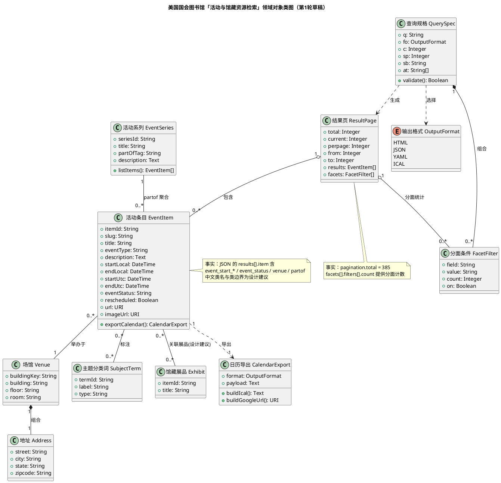
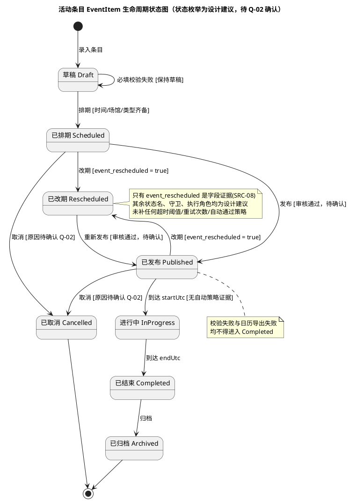
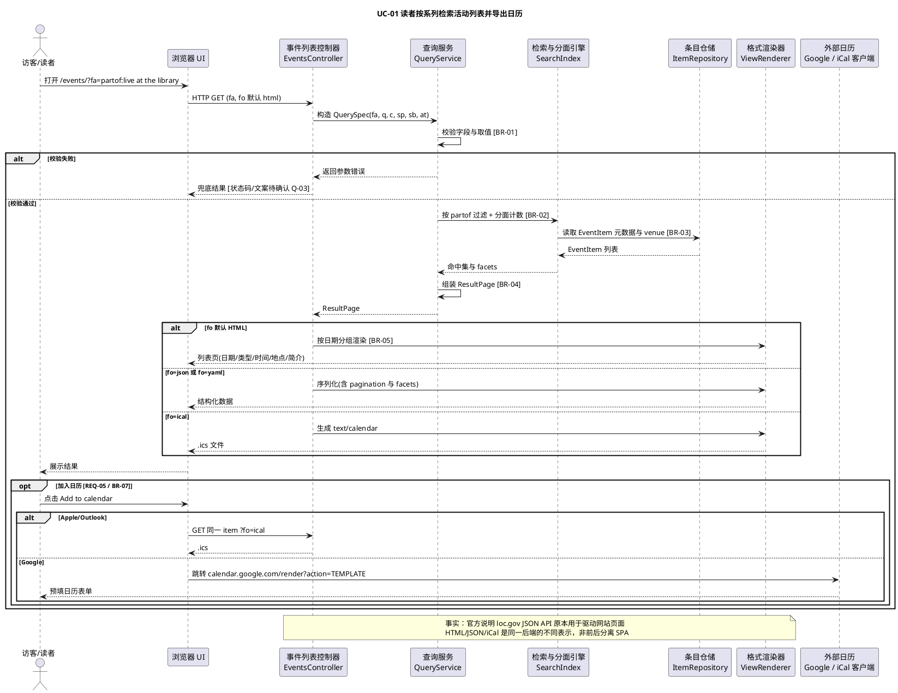
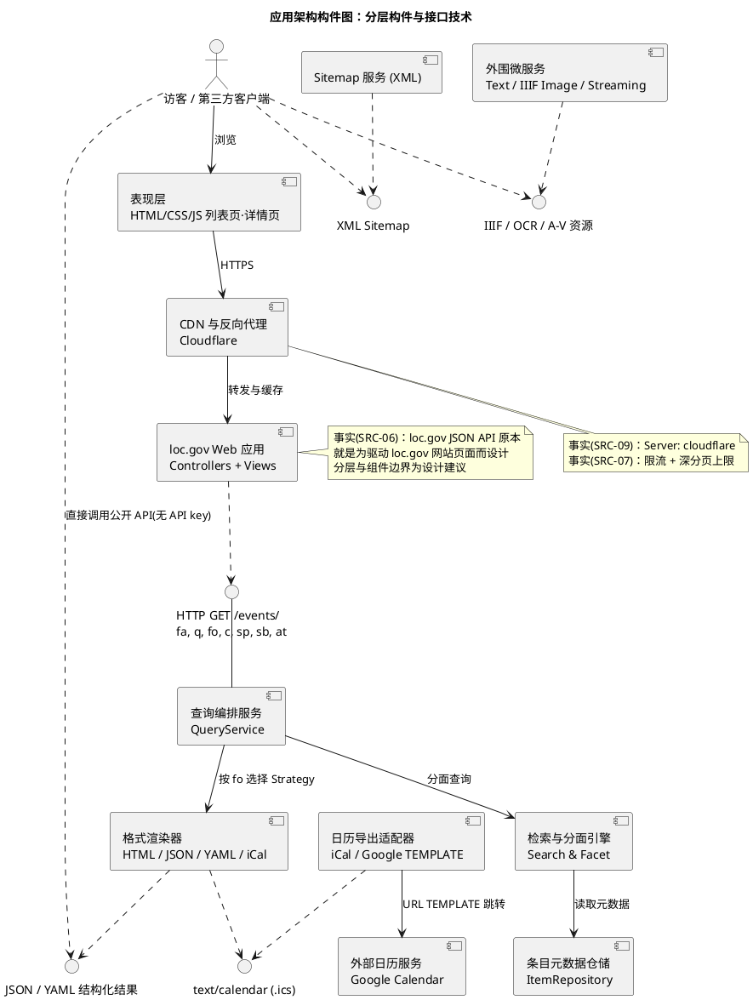

# 美国国会图书馆（loc.gov）作为图书管理系统的应用架构分析 · PRD 明细底稿

> **第 2 轮定稿为 Markdown 作业文档**：`作业交付/美国国会图书馆应用架构分析.md`（图片以相对路径内嵌，可直接预览）；另附 Mermaid 单文件版与自包含 HTML 预览版。
> 第 2 轮按用户确认：保持检索子系统范围、不纳入流通域；新增「内容发布后台」（REQ-12/13、BR-09、R4、状态 PendingReview/Withdrawn）与「智能体检索入口」（REQ-14/15、R6、工具与权限成对定义）；状态载体沿用 EventItem。
> 四份 `.puml` 与 `figs/*.png` 已同步更新为第 2 轮版本；本 PRD 保留逐项明细（SRC/REQ/BR/AC/追溯/Q 表）与第 10 节完整图源码，与第 2 轮 Markdown 文档配套使用。变更清单见作业文档附录 B。
>
> 版本 v0.1 ｜ 生成日期 2026-11-13 ｜ 建模方法：B 端系统 UML 架构设计（PRD + 图源码）
> 图语言：PlantUML（未指定则按默认）｜ 验证状态：**源码已自检，未在渲染器实测**（本机无 Java / PlantUML）
>
> **重要约定**：本文严格区分三类内容——
> - **原文事实**：可从 SRC 材料直接观察到的；
> - **设计建议**：为完成作业而做的架构推断，不是 LOC 官方公布的实现；
> - **待确认**：需你回答 Q 表问题后才能定稿的。
>
> LOC 官方并未公开其内部源码与架构文档，因此"软件架构体系与设计模式"属于**依据可观察接口与响应结构做的逆向推断**，不能作为对美方系统的实现断言。

---

## 1. 背景、业务目标、范围

| 项 | 内容 |
|---|---|
| 分析对象 | `https://www.loc.gov/events/?fa=partof:live%20at%20the%20library`（"Live! At The Library" 系列活动列表页） |
| 业务目标 | 把该网站**抽象为一个图书管理系统**，分析其领域对象、应用架构、接口层，并输出状态图、交互图、类图、构件图与架构体系/设计模式 |
| 作业依据 | 截图要求："对照今天课程内容的领域对象建模、系统应用架构设计、接口层设计中的原则、要求及案例内容，分析美国国会图书馆网站的状态图、交互图、类图、构件图及其软件架构体系和设计模式" |
| 范围内 | 活动/馆藏资源的检索、分面过滤、列表与详情展示、日历导出、公开 API 及其接口技术、由可观察证据支撑的架构推断 |
| 范围外 | 读者证/借书/还书/逾期/罚款等传统流通业务（该页面**没有任何证据**，若纳入必须显式标为设计建议，见 Q-01）；LOC 内部数据库表结构、真实部署拓扑、源码 |

**材料版本**：LOC 页面抓取于 2026-11-13；页面显示的活动日期为 2026-11-19 至 2026-12-24；JSON 实测 `pagination.total = 385`。

---

## 2. 术语与来源清单（SRC）

| SRC | 材料位置 | 原文或忠实摘要 | 事实状态 |
|---|---|---|---|
| SRC-01 | LOC events 列表页（WebFetch） | 标题 "Events at the Library of Congress, Available Online, Live at the Library"；按日期分组（Thursday November 19 / December 3 / 10 / 17 / 24, 2026）；每条含 `Event \| 类型`、时间（含 EST）、地点、简介、"Add to calendar" | 原文事实 |
| SRC-02 | 详情页 URL | `/item/event-419732/live-at-the-library/2026-11-19/`；同一标题在 11/19、12/03、12/10、12/17、12/24 分别为 `event-419732 / 419734 / 419736 / 419738 / 419740`，即**同系列多场次各为独立条目** | 原文事实 |
| SRC-03 | 列表页查询串 | `?fa=partof:live%20at%20the%20library`，`fa` 为分面过滤，`partof:` 为"字段:值"限定语法 | 原文事实 |
| SRC-04 | 列表页日历链接 | 同一详情页加 `?fo=ical` 输出 Apple/Outlook 日历文件 | 原文事实 |
| SRC-05 | 列表页 Google 链接 | `calendar.google.com/calendar/render?action=TEMPLATE&text=&details=&dates=&ctz="America/New_York"&location=&sprop=website&name=` —— 通过 URL 参数跳转外部系统 | 原文事实 |
| SRC-06 | 官方 API 总览 `loc.gov/apis/` | 三类公开 API：① JSON/YAML for loc.gov（**原本就是为驱动 loc.gov 网站页面而设计**，除 HTML 外还能给 JSON）；② Sitemaps（XML）；③ Microservices（Text Services / IIIF Image Services / Streaming Services） | 原文事实 |
| SRC-07 | 官方 JSON/YAML 文档 `loc.gov/apis/json-and-yaml/` | 提供 JSON 与 YAML；**无需 API key、无需认证**；有 rate limiting；深分页上限（不保证能翻到第 100,000 条之后）；建议用 facet 缩小结果 | 原文事实 |
| SRC-08 | 实测 `?fo=json&c=1&fa=partof:...` 响应 | 顶层 36 键；`pagination` 含 `total/perpage/current/from/to/page_list` 等 13 字段；`facets[].type` = dates / location_presence / location_campus / subject / partof，每 filter 含 `count/on/off/value/title`；`facet_views` = calendar/chart/current/list；`results[]` 28 字段；`item` 59 字段，含 `event_status / event_rescheduled / event_series / event_start_utc / event_start_date_local / event_to_be_recorded / livestream / registration_period / ticket_options / venue / building_address` 等 | 原文事实 |
| SRC-09 | 站点响应头（curl） | `Server: cloudflare`，`Cf-Mitigated: challenge`（直连触发 403 质询）；`X-Frame-Options: SAMEORIGIN`、`Referrer-Policy: same-origin` | 原文事实（仅说明前置 CDN/防护，不代表全站拓扑） |
| SRC-10 | 教材 `ch04.html` 行 14–53 | 结构化设计 SD：模块独立性（耦合/内聚）、结构图 SC、变换/事务分析（DFD→结构图）、IPO 图；耦合 7 类（内容→公共→外部→控制→标记→数据，补充消息耦合）；内聚 7 类（偶然→…→功能，补充信息内聚） | 教材知识点 |
| SRC-11 | 教材 `ch04.html` 行 54–79 | 架构风格：SOA / 微服务 / EDA / 容器 / Serverless / 智能体架构可组合；**"不要为了用微服务而把每个功能都拆成独立服务"**；选择提示：小系统先用模块化单体，跨系统复用考虑 SOA，独立扩容才上微服务 | 教材知识点 |
| SRC-12 | 教材 `ch04.html` 行 80–112 | OOD：类图（类/属性/操作/关联聚合继承）、交互图（时序图）、状态图（生命周期）、SOLID；理论↔智能体映射；4 幅理论图（总体设计四原则、智能体三大组成、**UML 组件图**、IPO 图）；并注明经典方法论"原版 ch8《领域对象建模》、ch10《系统应用架构设计》、ch11《接口层设计》、ch12《面向对象设计》…深度速查见附录 H.3 类图/状态图、H.4 顺序图/协作图、H.5 SOLID 与 GoF 23 模式、H.6 面向服务与微服务/API" | 教材知识点 |
| SRC-13 | 教材 `ch04.html` 行 143–175、167–168 | 4.1 四基石（模块化/高内聚低耦合/可复用/易维护）；4.2 人设+工具与知识接口+记忆；4.3 插件/工作流/对话流/卡片选型判据；4.4 防御性设计（异常/兜底分支、边界处理）；4.5 插件入参出参 JSON、`{{变量}}` 串联；4.6 编排画布 | 教材知识点 |
| SRC-14 | 作业截图 | 要求对照"领域对象建模 / 系统应用架构设计 / 接口层设计"，产出状态图、交互图、类图、构件图 + 软件架构体系和设计模式 | 原文事实 |

> 说明：教材数字版只提供 ch01–ch09，`ch10.html` / `pages/appendix.html` 返回 404；"原版 ch8/ch10/ch11" 的内容以 ch04 中明确的**理论基石段落 + 附录 H 索引**为对照依据，不臆造原文。

---

## 3. 教材知识点 ↔ 本次分析对照表（作业得分点）

| 课程/教材知识点 | 出处 | 在 LOC 分析中的落点 |
|---|---|---|
| 领域对象建模：类、属性、操作、关联/聚合/继承 | SRC-12（ch04 行 81） | 第 7 节对象表、FIG-01 类图：EventSeries / EventItem / Venue / SubjectTerm / Exhibit / QuerySpec / ResultPage |
| 状态图＝对象生命周期 | SRC-12 | 第 7 节状态迁移表、FIG-02：EventItem 由排期到归档；`event_rescheduled` 是唯一有字段证据的旁支 |
| 交互图（时序图）＝对象间消息顺序 | SRC-12 / 附录 H.4 | FIG-03：UC-01 检索与日历导出的消息序列，含 alt 分支 |
| 构件图（UML 组件图） | SRC-12 图 3 / 附录 H.3 | FIG-04：分层构件 + provided/required 接口（lollipop） |
| 总体设计四原则：模块化 / 高内聚 / 低耦合 / 可复用 | SRC-13（4.1） | 第 9 节：按"表现—应用—领域—基础设施"分层；Renderer 可插拔（OCP）；QuerySpec 为精简 DTO |
| 耦合类型判读 | SRC-10 | 第 9.3 节：`fo=ical` 与 Google TEMPLATE 属**外部耦合**→用 Adapter 隔离；视图若接收整个 59 字段 item 属**标记耦合**→用 `at=` 字段选择/DTO；QuerySpec 只传必要参数属**数据耦合** |
| 内聚类型判读 | SRC-10 | 第 9.3 节：分面统计、格式渲染、日历适配各自**功能内聚**；不得把"发通知+统计+生成 HTML"塞进一个模块（偶然内聚） |
| 结构图 SC / DFD→模块 / IPO | SRC-10 | 第 9.4 节：列出"事件列表查询"的父/子模块与 IPO（输入 fa/fo/c/sp → 处理 校验·检索·聚合·渲染 → 输出 HTML/JSON/iCal） |
| 架构风格选型（单体/SOA/微服务/EDA/云原生） | SRC-11 | 第 9.1 节：判定为**模块化单体 + 面向资源 API + 搜索引擎分面**，微服务只存在于外围 Text/IIIF/Streaming；EDA 无证据，标"不适用" |
| 接口层设计 / API 网关 / SOA | SRC-11 行 59、SRC-12 附录 H.6 | 第 8 节：统一入口、稳定契约、限流与深分页治理、无认证开放、CDN 前置 |
| 防御性设计 | SRC-13（4.4） | 第 9.5 节：参数校验兜底、空结果、时区双字段（UTC + local）、限流/深分页上限、外部日历失败不影响主流程 |
| SOLID 与 GoF 设计模式 | SRC-12 / 附录 H.5 | 第 9.2 节：SRP/OCP/DIP/ISP + Front Controller、MVC、Strategy、Adapter、Facade、Repository、Specification、Proxy(Cache)、Template Method |
| 智能体映射（本章特色） | SRC-12 行 82–87、SRC-13 4.3 | 第 9.6 节：把"感知—决策—行动"映射到"接收 QuerySpec—选择输出格式—调用检索/导出工具"；说明本次**不引入智能体**，理由按 4.3 判据 |

---

## 4. 角色与权限矩阵

> 权限矩阵＝"谁能对哪些数据做什么"。LOC 页面是匿名可读的公开站点，**没有任何登录/授权证据**，因此除"读取"外的全部权限均写"待确认"，不把管理员默认设为全权。

| 角色ID | 角色 | 对象 | 动作 | 数据范围 | 前置条件 | 允许／禁止／待确认 | 来源 |
|---|---|---|---|---|---|---|---|
| R1 | 公众访客／读者（人类，匿名） | 已发布 EventItem、分面统计、日历导出 | 检索、浏览、导出日历 | 全部公开条目 | 无（API 无 key） | **允许** | SRC-01/04/07 |
| R2 | 第三方程序／爬虫（外部系统） | JSON/YAML 结果、Sitemap、Microservices | 读取结构化数据 | 公开集合 | 遵守限流与深分页上限 | **允许（有限制）** | SRC-06/07 |
| R3 | Google Calendar／日历客户端（外部系统） | 单条 EventItem 的日历表示 | 接收 URL TEMPLATE 或 .ics | 单条 | 用户主动点击 | **允许** | SRC-04/05 |
| R4 | 馆员／内容编辑（人类） | EventItem 元数据、状态 | 创建、改期、发布、取消 | 待确认 | 待确认 | **待确认（设计建议）** | SRC-08 字段暗示，Q-01 |
| R5 | 读者账户／借阅域（人类） | 预约、席位、借阅记录 | 预约、借还 | 本人 | 需统一身份认证 | **待确认（超出本页范围）** | Q-01 |

---

## 5. 功能需求（REQ）

| REQ | 功能需求 | 业务目标／成功结果 | 事实／建议／待确认 | SRC | 优先级 |
|---|---|---|---|---|---|
| REQ-01 | 按"所属系列"过滤活动（`fa=partof:...`） | 只返回该系列条目 | 原文事实 | SRC-03 | 用户未给，不强排 |
| REQ-02 | 结果按日期分组展示 | 读者按日浏览 | 原文事实 | SRC-01 | 同上 |
| REQ-03 | 每条展示类型、起止时间、地点、简介 | 无需跳转即可判断 | 原文事实 | SRC-01 | 同上 |
| REQ-04 | 跳转到活动详情资源页 | 获取完整信息 | 原文事实 | SRC-02 | 同上 |
| REQ-05 | 导出日历：iCal 与 Google Calendar | 加入个人日程 | 原文事实 | SRC-04/05 | 同上 |
| REQ-06 | 同一资源多种表示：HTML / JSON / YAML / iCal | 人机共用一套后端 | 原文事实 | SRC-04/06/07 | 同上 |
| REQ-07 | 分页与分面统计（count） | 大规模集合可用 | 原文事实 | SRC-08 | 同上 |
| REQ-08 | 视图切换：calendar / chart / list | 多视角浏览 | 原文事实 | SRC-08 `facet_views` | 同上 |
| REQ-09 | 活动条目关联馆藏展品（exhibits 类目） | 把"活动"接入"馆藏"域 | **设计建议**（页面确有 Gutenberg Bible 等展品条目，但无显式关联字段） | SRC-01 | 待确认 |
| REQ-10 | 内容发布/审核/改期/取消的后台流程 | 支撑状态图 | **设计建议**，状态枚举待确认 | SRC-08 `event_status` 等 | Q-01/Q-02 |
| REQ-11 | 读者预约/席位/借阅流通 | 构成完整"图书管理系统" | **待确认，超出本页证据** | 无 | Q-01 |

---

## 6. 核心用例 UC-01：按系列检索并浏览活动列表

- **关联 REQ**：REQ-01/02/03/04/05/06/07/08
- **参与角色**：R1 访客；R3 外部日历（可选分支）
- **触发**：访客打开 `/events/?fa=partof:live at the library`
- **前置条件**：无登录、无 API key（SRC-07）
- **主流程**

| 步骤 | 执行方 | 动作 | 结果／规则 |
|---|---|---|---|
| 1 | 访客 | 发起带 `fa` 的 GET | 浏览器 → 表现层 |
| 2 | EventsController | 解析 `fa/q/fo/c/sp/sb/at`，构造 QuerySpec | BR-01 |
| 3 | QueryService | 校验字段与取值，失败走兜底 | BR-01、Q-03 |
| 4 | Search & Facet Engine | 按 `partof` 过滤，计算各分面 count | BR-02 |
| 5 | ItemRepository | 取 EventItem 元数据与 venue | BR-03 |
| 6 | QueryService | 组装 ResultPage（pagination + facets + results） | BR-04 |
| 7 | Renderer | 按 `fo` 选择 HTML / JSON / YAML / iCal 渲染；HTML 按日期分组 | BR-05 |
| 8 | 访客 | 阅读列表；可选点击 Add to calendar | REQ-05 |

- **备选／异常路径**
  - A1（步 3）：参数非法 → 返回参数错误或空结果页；**具体状态码与文案待确认 Q-03**，不默认写成 400。
  - A2（步 4）：无命中 → 返回空 `results` 与零值分面；页面文案待确认。
  - A3（步 4）：超出限流/深分页上限 → 官方声明会被阻断或失败；**具体错误码待确认 Q-03**（SRC-07）。
  - A4（步 8）：Google 日历不可达 → 主流程已成功，导出失败不影响列表；兜底策略待确认（防御性设计，SRC-13）。
- **成功后置条件**：访客获得按日期分组的结果页，或结构化结果；ResultPage 不改变任何服务端状态（只读用例）。
- **失败后置条件**：不产生"已成功"假象；状态保持为"未获得结果"，不生成借阅/预约记录。

---

## 7. 业务规则、数据对象与状态迁移

### 7.1 业务规则

| BR | 条件 | 动作／约束 | 例外 | 事实状态 | SRC／Q |
|---|---|---|---|---|---|
| BR-01 | 请求带查询参数 | 字段与取值校验；`fa` 采用 `字段:值` 语法 | 非法值处理待确认 | 事实 + 待确认 | SRC-03、Q-03 |
| BR-02 | 指定 `partof` 分面 | 只返回属于该系列的条目；同时给出各分面命中数 | — | 原文事实 | SRC-03/08 |
| BR-03 | 条目含 UTC 与本地两套时间 | 展示用 `America/New_York` 本地时间，导出/排序用 UTC | 夏令时切换规则待确认 | 事实 + 待确认 | SRC-05/08、Q-03 |
| BR-04 | 结果集过大 | 用 `c`/`sp` 分页；`pagination` 返回 total/perpage/page_list | 深分页上限 | 原文事实 | SRC-07/08 |
| BR-05 | `fo` 指定输出格式 | 选择对应 Renderer；默认 HTML | YAML/iCal 字段裁剪待确认 | 事实 + 待确认 | SRC-04/06 |
| BR-06 | 同系列多场次 | 每个日期是独立 item id，共享 title 与 partof | — | 原文事实 | SRC-02 |
| BR-07 | 点击日历导出 | iCal 由本站 `?fo=ical` 生成；Google 由 URL TEMPLATE 跳转 | — | 原文事实 | SRC-04/05 |
| BR-08 | 条目状态变更（改期/取消/发布） | 需后台流程与状态枚举 | 全部规则待确认 | **设计建议** | SRC-08、Q-02 |

### 7.2 关键对象与字段（只纳入业务需要的字段）

| 对象 | 关键字段／关系 | 含义 | 必填／唯一／校验 | SRC |
|---|---|---|---|---|
| EventSeries 活动系列 | seriesId、title、partOfTag、description | `partof` 指向的聚合 | partOfTag 用于 `fa` 过滤 | SRC-02/03 |
| EventItem 活动条目 | itemId（如 `event-419732`）、slug、title、eventType、description、start/end（UTC+local）、eventStatus、rescheduled、url、imageUrl、partof | 一条可检索资源 | itemId 唯一；URL = `/item/{itemId}/{slug}/{date}/` | SRC-02/08 |
| Venue 场馆 | buildingKey、building、floor、room、address | Thomas Jefferson Building 等 | 层级结构见 `item.venue` | SRC-01/08 |
| SubjectTerm 主题/分类词 | termId、label、type | special events / concerts and performances / exhibits and tours | 受控词表（推断） | SRC-01/08 |
| Exhibit 馆藏展品 | itemId、title | 与活动关联的馆藏 | 关联关系为设计建议 | SRC-01、REQ-09 |
| QuerySpec 查询规格 | q、fa[]、fo、c、sp、sb、at | 一次请求的输入契约 | 精简字段，避免标记耦合 | SRC-03/07/08 |
| FacetFilter 分面条件 | field、value、count、on/off | 过滤与计数 | field ∈ {dates, partof, subject, location_*} | SRC-08 |
| ResultPage 结果页 | total、current、perpage、from/to、results[]、facets[]、page_list[] | 输出契约 | total=385（实测） | SRC-08 |
| CalendarExport 日历导出 | format、payload | iCal / Google TEMPLATE | 格式区分 | SRC-04/05 |

### 7.3 状态迁移表（对象：EventItem）

> **只有 `event_rescheduled` 是字段证据**；下列状态名与守卫均为**设计建议**，需 Q-02 确认后才能定稿。不补任何超时阈值、重试次数、自动通过策略。

| 对象 | 源状态 | 事件 | 守卫条件 | 执行角色 | 目标状态 | 副作用 | BR／SRC／Q |
|---|---|---|---|---|---|---|---|
| EventItem | （初始） | 录入 | — | R4（待确认） | Draft 草稿 | 生成 itemId | Q-02 |
| EventItem | Draft | 校验 | 必填项不通过 | R4 | Draft（保持） | 返回校验原因 | BR-01、Q-02/Q-03 |
| EventItem | Draft | 排期 | 时间/场馆/类型齐备 | R4 | Scheduled 已排期 | 写入 UTC+local 时间 | BR-03、Q-02 |
| EventItem | Scheduled | 发布 | 审核通过（待确认） | R4 | Published 已发布 | 对 R1 可见 | Q-01/Q-02 |
| EventItem | Published | 到达开始时间 | 时间到达（无自动策略证据） | 系统（建议） | InProgress 进行中 | 列表可标记 | Q-02 |
| EventItem | InProgress | 到达结束时间 | — | 系统（建议） | Completed 已结束 | — | Q-02 |
| EventItem | Completed | 归档 | — | R4 | Archived 已归档 | 保留可检索 | Q-02 |
| EventItem | Published / Scheduled | 改期 | `event_rescheduled = true` | R4 | Rescheduled 已改期 | 更新时间并重新发布 | SRC-08（**字段证据**） |
| EventItem | Rescheduled | 重新发布 | 审核通过（待确认） | R4 | Published | 通知策略待确认 | Q-02 |
| EventItem | Published / Scheduled | 取消 | 原因待确认 | R4 | Cancelled 已取消 | 是否仍可检索待确认 | Q-02 |

**一致性要求**：撤回 ≠ 驳回 ≠ 取消，不合并；终态 Archived/Cancelled 是否可重新打开待 Q-02；校验失败与导出失败**不得**进入 Completed。

---

## 8. 接口层设计与接口技术结论

### 8.1 可观察的接口事实

| 维度 | 结论 | 证据 |
|---|---|---|
| 传输协议 | HTTPS + HTTP GET；响应头 `Server: cloudflare`（前置 CDN/防护） | SRC-09 |
| 资源定位 | REST-like 面向资源 URI：`/events/`（集合）、`/item/{itemId}/{slug}/{date}/`（单体） | SRC-02 |
| 内容协商 | **通过查询参数 `fo` 而非 Accept 头**：`fo=json` / `fo=yaml` / `fo=ical` / 默认 HTML | SRC-04/06/07 |
| 查询参数 | `fa`（分面过滤，`字段:值`）、`q`（检索）、`c`（每页条数）、`sp`（页码）、`sb`（排序）、`at`（返回字段裁剪）、`fo`（输出格式） | SRC-03/07/08 |
| 响应结构 | JSON：顶层含 `results`、`content.results`、`pagination`、`facets`、`facet_trail`、`facet_views`、`views`、`timestamp` 等；`pagination` 13 字段；`facets[].filters[]` 带 `count/on/off`；`results[].item` 59 字段 | SRC-08 |
| 其他格式 | Sitemap = XML；Text Services = OCR/词坐标；Image Services = **IIIF** 兼容；Streaming = 音视频投递 | SRC-06 |
| 认证与治理 | 公开、无 API key、无认证；有 rate limiting 与深分页上限；建议用 facet 缩小结果集 | SRC-07 |
| 外部集成 | iCal 由本站生成（`text/calendar`）；Google Calendar 靠**客户端跳转 + URL TEMPLATE 传参**，不是服务端 API 调用 | SRC-04/05 |
| 数据契约 | 时间同时给 UTC 与本地（`event_start_utc` / `event_start_date_local` / `ctz`） | SRC-05/08 |

### 8.2 接口技术定性（回答"接口技术是哪种"）

1. **主体是"面向资源的 HTTP API / 务实型 REST（REST-like）"**，而非严格 REST：资源用 URI 标识、无状态 GET、可缓存；但用 `fo=` 查询参数做格式协商、用 `fa/q/c/sp` 表达查询，属于**查询参数驱动的 RPC 风格混合**，不能写成"纯 RESTful"。
2. **同一后端、多种表示（Multi-Representation）**：官方明确 loc.gov JSON API 原本就是为驱动网站 HTML 页面而设计（SRC-06）。因此"网页"与"API"是**同一应用的两张视图**，这不是"前端调后端 API 的前后分离 SPA"，而是**服务端渲染 + 同一数据契约多序列化器**。这一点是本次分析最容易被写错的地方。
3. **搜索引擎/分面检索型读模型**：`fa`、`facets[].count`、`facet_views` 说明后端有索引与分面聚合能力，读路径以查询为主；与教材"结构图/变换分析"中的**事务型**借阅流程不同，属**变换型（输入查询→变换→输出视图）**。
4. **外围是专用微服务 + 开放标准**：IIIF（图像）、OCR、流媒体各自独立，符合教材 SRC-11"按业务边界拆、不为微服务而微服务"。
5. **接口层设计原则对照**：统一入口（Front Controller/Facade）、稳定最小契约（数据耦合/消息耦合）、外部格式用 Adapter 隔离（外部耦合）、限流与分页上限（防御性设计）、字段裁剪 `at=` 避免标记耦合。

---

## 9. 软件架构体系与设计模式

### 9.1 架构体系判定（分层）

| 层 | 构件 | 职责 | 教材对照 |
|---|---|---|---|
| L1 表现层 | 浏览器 HTML/CSS/JS、列表页/详情页、日历视图 | 按日期分组渲染、Add to calendar | 4.1 模块化 |
| L2 接口/应用入口层 | CDN/反向代理、EventsController、统一查询参数解析 | 路由、缓存、限流、内容协商 | 附录 H.6 / API 网关（SRC-11 行 59） |
| L3 应用/编排层 | QueryService、ResultPage 组装、Renderer 选择 | 校验→检索→聚合→渲染的编排 | 结构图 SC、工作流编排（SRC-13 4.6） |
| L4 领域层 | EventSeries / EventItem / Venue / SubjectTerm / FacetFilter / CalendarExport | 业务概念与规则 | OOD 类图（SRC-12） |
| L5 基础设施层 | 检索与分面引擎、ItemRepository、Sitemap、Text/IIIF/Streaming 微服务、外部日历 | 持久化与集成 | Repository / Adapter / 微服务 |

**风格结论（设计建议）**：**分层 + 模块化单体 + 面向资源 API + 索引驱动的读模型**；外围挂接少数专用微服务。
- **不判为全站微服务**：官方只列出三类外围 microservices（SRC-06），主站与 API 同源（SRC-06）；符合教材 SRC-11"小系统先用清晰的模块化单体"。
- **不判为 EDA**：页面与 API 中没有任何事件发布/订阅证据 → 明确写"无证据、不适用"，不为了凑架构风格硬加。
- **不判为 SPA 前后分离**：页面为服务端渲染，HTML 与 JSON 出自同一应用。
- **可类比为 CQRS 的读侧**：写侧（后台录入/发布）不在本页可见范围内，标 Q-01。

### 9.2 设计模式映射（对照附录 H.5 / SOLID）

| 模式 | 在 LOC 中的体现 | 证据强度 | SOLID |
|---|---|---|---|
| Front Controller / 统一入口 | `/events/` 单一入口统一解析 `fa/q/fo/c/sp` | 事实 | SRP |
| MVC（Model-View-Controller） | Model=EventItem 元数据；View=HTML/JSON/YAML/iCal；Controller=查询编排 | 事实 + 推断 | SRP/ISP |
| Strategy（策略） | `fo` 选择不同 Renderer，新增格式不改核心查询 | 事实 + 推断 | **OCP** |
| Adapter（适配器） | iCal 生成、Google TEMPLATE URL 参数适配，隔离外部格式 | 事实 | **DIP**（教材行 34 外部耦合） |
| Facade / API Gateway | 统一公开 API、限流、深分页治理、CDN 前置 | 事实 | DIP/ISP |
| Repository / DAO | ItemRepository 隔离元数据访问 | 推断（附录 H.7） | **DIP** |
| Specification / Builder | QuerySpec 组合 `fa[] + q + c + sp + sb + at` 成查询条件 | 事实 + 推断 | SRP |
| Proxy / Cache | Cloudflare CDN 缓存与质询 | 事实（SRC-09） | — |
| Template Method | 列表页按日期分组的模板化渲染 | 推断 | LSP |
| Observer / EDA、Singleton、工厂方法 | 本页无证据，仅可作为设计建议 | **不适用/建议** | — |

### 9.2b 设计模式补强对照（第 3 轮，依据教材附录 H.5）

完整的「四基石 → SOLID 五原则 → GoF 三分类 → 教材案例 → 排除清单」逐条对照见最终作业文档《美国国会图书馆应用架构分析.md》第九章 9.2–9.9；本节只记录结论要点，避免两处结论分叉：

- **四基石**（行 144）：模块化＝L1–L5 分层；高内聚低耦合＝见 9.3；可复用＝同一 QueryService / ResultPage 被 HTML、JSON、YAML、iCal 与第三方客户端复用（SRC-06，事实）；易维护＝新增 `fo=xxx` 只增 Renderer（设计建议）。
- **SOLID**（行 81）：SRP＝各层单一职责；OCP＝Strategy 的 `fo`；LSP＝Renderer 可替换（无继承证据，设计建议）；ISP＝`at=` 字段裁剪避免 59 字段胖接口；DIP＝Repository 与 CalendarExport 隔离具体实现。
- **GoF 三分类**（附录 H.5）：结构型 Adapter / Facade / Proxy 与行为型 Strategy / Template Method / Specification 有可观察证据；创建型 Factory Method、Abstract Factory、Singleton，以及 Decorator、Composite、Observer、Chain of Responsibility、Command 一律标记「无证据」并列入排除清单。**无证据 ≠ 内部未使用**，不逐条硬套 23 种模式。
- **智能体模式**（行 120、184–185、203–205）：本用例选工作流式编排（Orchestrator）；ReAct 与 Agentic 架构仅在第 10 章作为可选设计建议；MCP 工具与权限成对（行 183）。

### 9.3 高内聚低耦合的具体判读（教材 SRC-10）

- **高内聚（功能内聚）**：分面统计、格式渲染、日历适配各自只回答一个问题；不应把"生成 HTML + 发通知 + 统计全馆热门"放进一个模块（偶然内聚）。
- **外部耦合** → 用 `CalendarExport` 适配器隔离 iCal/Google 的固定报文格式，改动只落在适配器内（教材行 34）。
- **标记耦合** → 若把 59 字段的 `item` 整个对象交给列表视图，就是"传整个读者档案"的同型问题；应通过 `at=` 字段裁剪或精简 DTO 只传标题/时间/地点/类型（教材行 36、37）。
- **数据/消息耦合** → QuerySpec 只传必需参数、ResultPage 只返回约定结果，双方依赖稳定契约而非对方内部实现（教材行 37、38）。
- **判断口诀落地**：把"欠费规则改了"换成"新增一种输出格式 `fo=xxx`"，若只需新增一个 Renderer 实现而不改 QueryService 与 Repository，则耦合达标。

### 9.4 结构图 SC 与 IPO（教材行 16/25/52）

- **父模块**：事件列表处理
  - 子模块：受理请求（解析参数）→ 校验查询规格 → 检索与分面统计 → 组装结果页 → 格式渲染 → 反馈结果
  - 模块间传递：QuerySpec、`List~FacetFilter~`、ResultPage、渲染结果；控制标记：校验通过/失败。
- **IPO（以"格式渲染"模块为例）**：I = ResultPage + `fo`；P = 选择 Renderer、按日期分组或序列化；O = HTML / JSON / YAML / iCal。
- **DFD ≠ 结构图 ≠ 流程图**：DFD 描述"查询条件→检索→结果"的数据流动；结构图描述模块调用层次；FIG-03 时序图描述消息时间顺序。三者不可互相替代。

### 9.5 防御性设计（教材 4.4，SRC-13）

| 失效点 | 恢复/兜底机制 | 证据 |
|---|---|---|
| 查询参数非法 / 无命中 | 空结果与参数错误兜底分支，不进入成功态；具体文案 Q-03 | 设计建议 |
| 超频 / 深分页 | 官方 rate limiting 与分页上限；客户端应改用 facet 收窄 | SRC-07（事实） |
| 时区与夏令时 | 同时保留 UTC 与 local、`ctz` 明确时区 | SRC-05/08（事实） |
| 外部日历不可用 | Google 跳转失败不影响主列表；iCal 失败给出明确原因 | 设计建议 |
| CDN 质询拦截自动化请求 | 直连返回 403 质询；接口层需区分浏览器与程序客户端 | SRC-09（事实） |

### 9.6 是否引入智能体架构（教材 4.3 判据）

按 4.3「插件=实时外部信息 / 工作流=步骤固定且结果稳定可控 / 对话流=多轮上下文 / 卡片=展示」的判据：本用例**步骤固定、结果稳定、无需多轮上下文**，应选**工作流式编排（QueryService）**，不需要 LLM 智能体；若将来做"帮读者找一场周四晚上的音乐会并加入日历"，才需要感知—规划—决策—行动 + 工具/记忆，且关键数据仍由有权限校验的业务服务给出（教材行 74–76）。

---

## 10. 图索引与完整图源码

| 图ID | 图种／语言 | 关联 UC／REQ／BR | 覆盖范围／缺口 | 自检／解析／渲染状态 |
|---|---|---|---|---|
| FIG-01 | 类图 / PlantUML | REQ-01~08、BR-02/03/04/06、SRC-08 | 领域对象与关系；流通域（读者/借阅）未纳入，见 Q-01 | 源码已自检，未在渲染器实测 |
| FIG-02 | 状态图 / PlantUML | REQ-10、BR-08、SRC-08 | EventItem 生命周期；状态枚举与守卫待 Q-02 | 同上 |
| FIG-03 | 交互图（时序图）/ PlantUML | UC-01、REQ-01/05/06/07、BR-01~05/07 | 检索主流程 + 三种输出 + 日历分支；错误码待 Q-03 | 同上 |
| FIG-04 | 构件图（UML 组件图）/ PlantUML | REQ-06/07、BR-05、SRC-06/07/09 | 分层构件与接口；真实部署拓扑无证据 | 同上 |

> 渲染方式（本机无 Java/PlantUML）：把 `.puml` 用 VS Code + PlantUML 插件打开，或用本地 `plantuml.jar` 生成 PNG/SVG；**不要把业务材料上传公共渲染站**。

### FIG-01 类图

### FIG-02 状态图

### FIG-03 交互图（时序图）

### FIG-04 构件图（UML 组件图）

---

## 11. 验收条件（AC）

| AC | 关联 REQ／BR／图分支 | 给定 | 当 | 则 |
|---|---|---|---|---|
| AC-01 | REQ-01/02、BR-02、FIG-03 校验通过分支 | 存在属于 "Live at the Library" 的条目 | 请求 `fa=partof:live at the library` | 结果仅含该系列条目，并按日期分组 |
| AC-02 | REQ-03、BR-03、FIG-01 | 某条目含 UTC 与本地时间 | 渲染 HTML 列表 | 显示 America/New_York 本地时间与场馆，不出现时区错置 |
| AC-03 | REQ-06、BR-05、FIG-03 alt 三分支 | 同一 QuerySpec | 分别请求默认 HTML、`fo=json`、`fo=ical` | 得到三种表示且 `results` 内容一致，不触发状态变更 |
| AC-04 | REQ-07、BR-04、FIG-01 | 结果总数 385 | 指定 `c` 与 `sp` | `pagination` 返回对应 total/perpage/page_list |
| AC-05 | REQ-05、BR-07、FIG-03 opt 分支 | 用户点击 Add to calendar | 选择 Apple/Outlook 或 Google | 分别得到 `.ics` 或跳转 TEMPLATE；Google 不可达时主列表仍成功 |
| AC-06 | BR-01、FIG-03 校验失败分支 | 非法 `fa` 字段 | 发起请求 | 不进入成功态、不产生记录；具体提示待 Q-03 |
| AC-07 | BR-08、FIG-02 | 条目处于 Published | 触发改期（`event_rescheduled=true`） | 进入 Rescheduled 并可重新发布，不直接进入 Completed/Archived |

> 未写任何性能指标：原始材料没有给出响应时间、并发量、可用性数值。

---

## 12. 追溯表、待确认项与非功能约束

### 12.1 追溯表

| REQ | SRC | UC | BR | 图ID | AC | 覆盖／缺口说明 |
|---|---|---|---|---|---|---|
| REQ-01 | SRC-03 | UC-01 | BR-01/02 | FIG-03, FIG-01 | AC-01 | 已覆盖 |
| REQ-02 | SRC-01 | UC-01 | — | FIG-03 | AC-01 | 已覆盖（渲染分支） |
| REQ-03 | SRC-01/08 | UC-01 | BR-03 | FIG-01 | AC-02 | 已覆盖 |
| REQ-04 | SRC-02 | UC-01 | BR-06 | FIG-01 | — | 类图覆盖关联；详情跳转未单独画交互分支 |
| REQ-05 | SRC-04/05 | UC-01 | BR-07 | FIG-03, FIG-04 | AC-05 | 已覆盖 |
| REQ-06 | SRC-04/06/07 | UC-01 | BR-05 | FIG-03, FIG-04 | AC-03 | 已覆盖 |
| REQ-07 | SRC-07/08 | UC-01 | BR-04 | FIG-01, FIG-04 | AC-04 | 已覆盖 |
| REQ-08 | SRC-08 | — | — | — | — | `facet_views` 仅记录，未建模视图切换流程（非流程需求，说明原因） |
| REQ-09 | SRC-01 | — | — | FIG-01 | — | 设计建议，关联关系待 Q-01 |
| REQ-10 | SRC-08 | — | BR-08 | FIG-02 | AC-07 | 状态枚举待 Q-02 |
| REQ-11 | 无 | — | — | — | — | **范围外／待确认 Q-01**，不伪造可追溯 |

### 12.2 待确认项（Q）

| Q | 缺失／冲突及原文依据 | 对模型的影响 | 待你补充的具体问题 | 受影响 ID |
|---|---|---|---|---|
| Q-01 | 本页无任何读者证、借书、预约、账户证据；作业要求"作为图书管理系统" | 决定是否引入 Patron/Loan/Reservation 与后台编辑角色、状态图是否改为预约生命周期 | 建模范围取哪一种：①只建"活动/馆藏资源检索子系统"（忠于证据）；②补足完整流通域（大量设计假设）；③加内容发布后台？ | REQ-09/10/11、R4/R5、FIG-01、FIG-02、权限矩阵 |
| Q-02 | JSON 只有 `event_status`、`event_rescheduled` 等**字段**，没有枚举值与迁移规则 | 状态图的状态名、守卫、终态能否定稿 | 状态载体选哪个：EventItem 发布生命周期 / 读者预约与席位 / 馆藏条目状态？状态枚举是否有课堂给定模板？ | BR-08、FIG-02、AC-07 |
| Q-03 | 官方只说有 rate limiting 与深分页上限，未给错误码与文案；参数校验规则未见 | 异常分支与验收条件能否写具体 | 是否需要把 403/429/空结果、参数非法、日历导出失败的兜底写成具体规则？ | BR-01/05、FIG-03、AC-06 |
| Q-04 | 图语言未指定 | 交付格式 | 是否需要改用 Mermaid（便于 Markdown/网页内嵌），或导出 Word/PDF 版作业文档？ | 全部 FIG |

### 12.3 非功能约束（仅记录材料中出现的要求）

| 要求 | 来源 | 验收方式或待确认 |
|---|---|---|
| 公开访问、无需认证 | SRC-07 | 匿名 GET 可用 |
| 限流 | SRC-07 | 具体阈值待确认 |
| 深分页上限（约第 100,000 条之后不保证） | SRC-07 | 建议用 facet 收窄，阈值非精确承诺 |
| 安全响应头（X-Frame-Options、Referrer-Policy、CSP 质询） | SRC-09 | 仅作观察记录 |
| 时区正确性 | SRC-05/08 | AC-02 |

### 12.4 风险

- **最大风险**：把"设计推断"写成"LOC 官方实现"。本文所有架构分层、类名、状态、模式均已标注，作业答辩时应说明是**基于可观察接口的逆向建模**。
- 数据快照时效性：页面与 JSON 会随活动更新变化（SRC-08 含 `timestamp` / `extract_timestamp`），引用数值需注明抓取日期。
- 直连 curl 被 Cloudflare 质询（SRC-09），复现实验需浏览器或合规客户端。

---

## 13. 验证记录

| 层级 | 结果 |
|---|---|
| 模型语义自检 | 已做：REQ→UC→BR→图→AC 使用同一 ID；校验失败与导出失败未误入成功态；状态迁移与 FIG-03 分支一致；权限矩阵未把 R4 默认设为全权 |
| 解析器语法 | **未实测**（本机无 `java` / `plantuml.jar`） |
| 渲染与可读性 | **未实测**，不声称已出图；四份 `.puml` 为完整自包含源码，需本地渲染后检查文字与分支 |
| 业务正确性复核 | 第 1 轮草稿，待 Q-01~Q-04 回答后定稿 |
