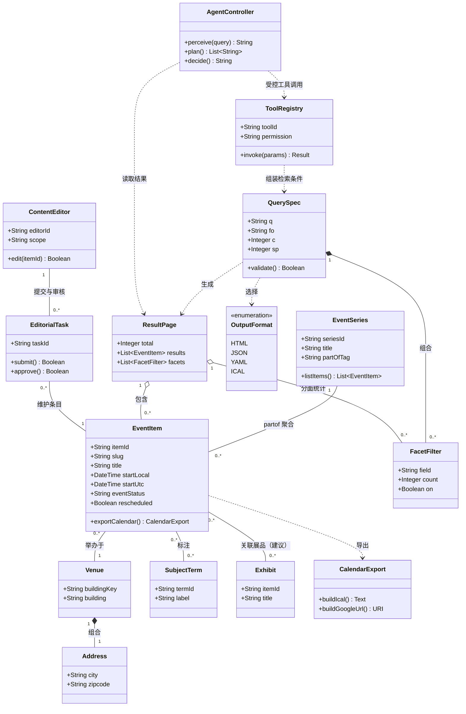
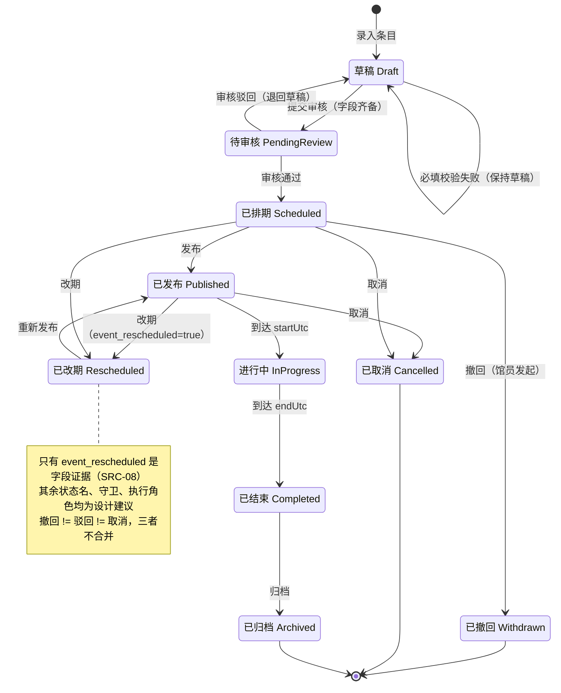
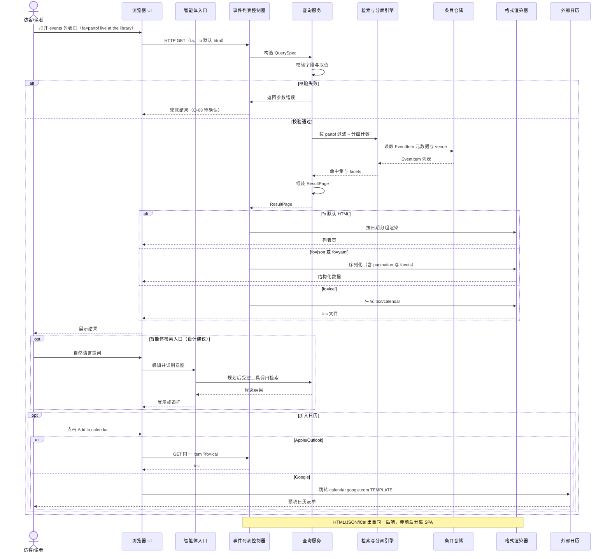
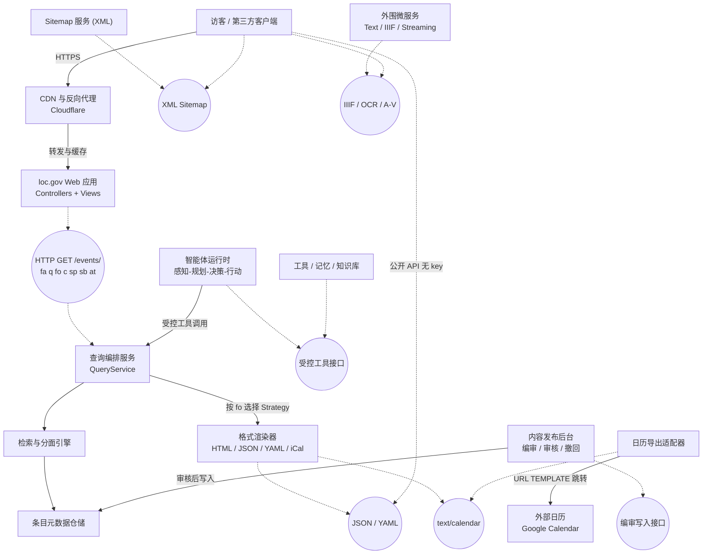

# 美国国会图书馆网站应用架构分析（图书管理系统视角）

课程：《信息系统分析与设计》第 4 章配套作业　｜　版本：Mermaid 单文件版　｜　作业日期：2026-11-13　｜　姓名／学号：____________

分析对象：`https://www.loc.gov/events/?fa=partof:live%20at%20the%20library`

> **图示说明（重要）**：本版是**零附件单文件版**，四张 UML 图用 Mermaid 代码块直接写在文档里，在 GitHub、Typora、VS Code（装 Mermaid 插件）等支持 Mermaid 的 Markdown 预览器中会自动渲染成图，不需要任何图片文件。若预览器不支持 Mermaid，请改用《美国国会图书馆应用架构分析.md》+ `figs/` 文件夹（PNG 相对路径内嵌）或直接打开 `预览.html`。Mermaid 的 flowchart 不等价于严格 UML 组件图，严格语义以 `*.puml` 源码和主交付版中的 PNG 为准。

## 一、作业要求、范围与方法

作业要求："对照今天课程内容的领域对象建模、系统应用架构设计、接口层设计中的原则、要求及案例内容，分析美国国会图书馆网站的状态图、交互图、类图、构件图及其软件架构体系和设计模式。"

本文把该网站抽象为一个图书管理系统中的「活动与馆藏资源检索子系统」。分析严格区分三类内容：

- **原文事实**：可从页面、URL、官方 API 文档或 JSON 响应直接观察到；
- **设计建议**：为完成建模而做的架构推断，不是 LOC 官方公布的实现；
- **待确认**：材料不足、需课堂规则才能定稿的部分。

必须说明：LOC 官方并未公开其内部源码与架构文档，因此"软件架构体系与设计模式"是**依据可观察接口与响应结构做的逆向推断**，答辩时应明确这一点。第 2 轮按确认结果，纳入**内容发布后台**与**智能体检索入口**两个模块，不纳入读者借阅流通域；状态图仍以活动条目生命周期为载体。

## 二、材料来源与证据清单

| SRC | 来源位置 | 关键事实 |
|---|---|---|
| SRC-01 | events 列表页 | 标题 "Events at the Library of Congress, Available Online, Live at the Library"；按日期分组；每条含类型、时间（EST）、地点、简介、Add to calendar |
| SRC-02 | 详情页 URL | `/item/event-419732/live-at-the-library/2026-11-19/`；同系列在 11/19、12/03、12/10 分别为 419732 / 419734 / 419736，即同系列多场次各为独立条目 |
| SRC-03 | 查询串 | `?fa=partof:live%20at%20the%20library`，`fa` 为分面过滤，`partof:` 为"字段:值"语法 |
| SRC-04 | 日历链接 | 同一详情页加 `?fo=ical` 输出 Apple/Outlook 日历文件 |
| SRC-05 | Google 日历链接 | `calendar.google.com/calendar/render?action=TEMPLATE&text=&details=&dates=&ctz=&location=`，通过 URL 参数跳转外部系统 |
| SRC-06 | 官方 `loc.gov/apis/` | 三类公开 API：JSON/YAML for loc.gov（**原本就是为驱动 loc.gov 网站页面而设计**）、Sitemaps（XML）、Microservices（Text / IIIF Image / Streaming） |
| SRC-07 | 官方 JSON/YAML 文档 | 提供 JSON 与 YAML；无需 API key 与认证；有 rate limiting 与深分页上限；建议用 facet 收窄结果 |
| SRC-08 | 实测 `?fo=json&c=1&fa=partof:...` | 顶层 36 键；`pagination` 13 字段、`total=385`；`facets[].filters[]` 带 `count/on/off`；`facet_views` = calendar/chart/current/list；`results[]` 28 字段；`item` 59 字段，含 `event_status`、`event_rescheduled`、`event_series`、`event_start_utc`、`event_start_date_local`、`venue`、`registration_period`、`ticket_options` 等 |
| SRC-09 | 站点响应头 | `Server: cloudflare`；直连触发 403 质询；`X-Frame-Options: SAMEORIGIN` |
| SRC-10 | 教材 `ch04.html` | 第 4 章「系统总体设计与智能体架构」的结构化设计、架构风格、OOD、组件图、防御性设计等知识点 |

## 三、教材知识点对照（作业得分点）

| 课程三块内容 | 教材出处（ch04） | 本文落点 |
|---|---|---|
| 领域对象建模 | 行 81：类图＝类/属性/操作及关联、聚合、继承；行 32–38 耦合类型；行 42–49 内聚类型 | 第五章类图、对象表；"整个 item 59 字段交给视图"属标记耦合，应用 `at=` 或精简 DTO |
| 系统应用架构设计 | 行 16 结构图 SC / DFD→模块 / IPO；行 54–79 架构风格选型；行 143–144 四基石原则 | 第四章分层架构；第九章风格判定、SC 与 IPO、SOLID 与 GoF 模式 |
| 接口层设计 | 行 59 API 网关与 SOA；行 112 附录 H.6 面向服务与 API；行 167–170 插件入参出参 JSON | 第八章接口技术结论与契约；第 10.2 节工具与权限成对定义 |
| 设计模式与原则 | 行 81 SOLID、行 112 附录 H.5（GoF 23）与 H.6、行 143–144 四基石、行 120 / 184–185 / 203–205 智能体模式 | 第九章：四基石逐条落地、SOLID 五原则、GoF 三分类对照、教材案例对照、明确排除清单 |

补充对应：状态图＝对象生命周期、交互图（时序图）＝对象间消息顺序（行 81）；UML 组件图见本章图 3；防御性设计见 4.4（行 167–168）。教材行 112 注明经典方法论「原版 ch8 领域对象建模、ch10 系统应用架构设计、ch11 接口层设计」已融入本章主线，深度速查见附录 H.3–H.6。

## 四、应用架构总体设计

判定为**分层 + 模块化单体 + 面向资源 API + 索引驱动的读模型**，外围挂接少数专用微服务。

| 层 | 构件 | 职责 |
|---|---|---|
| L1 表现层 | 列表页、详情页、日历视图 | 按日期分组渲染、Add to calendar |
| L2 接口入口层 | CDN/反向代理、统一 GET 入口 | 路由、缓存、限流、内容协商 |
| L3 应用编排层 | QuerySpec 校验、检索与分面聚合、ResultPage 组装、Renderer 选择 | 工作流式编排 |
| L4 领域层 | EventSeries / EventItem / Venue / SubjectTerm / FacetFilter / CalendarExport | 业务概念与规则 |
| L5 基础设施层 | 检索索引、ItemRepository、Sitemap、Text/IIIF/Streaming、外部日历 | 持久化与集成 |

三条排除性结论：**不判为全站微服务**（官方只列三类外围 microservices，主站与 API 同源，符合教材行 79"小系统先用清晰的模块化单体"）；**不判为 EDA**（无事件发布/订阅证据）；**不判为前后分离 SPA**（页面为服务端渲染，HTML 与 JSON 出自同一应用）。

## 五、类图（领域对象建模）

**图 1　领域对象类图（FIG-01）**

> Mermaid 等价示意；严格 UML 语义与完整属性以主交付版中的 PNG 与 `fig1_class.puml` 为准。

关键判断一：同一 "Live! At The Library" 在不同日期有不同 item id，说明**「系列活动」与「单场条目」是两个对象、聚合关系，不是继承**。关键判断二：`item.venue`、`partof`、`facets[].filters[].count` 分别支撑 Venue、FacetFilter、ResultPage。关键判断三：后端 `item` 有 59 个字段，视图若接收整个对象即教材行 36 的**标记耦合**，应只传标题、时间、地点、类型或借 `at=` 字段裁剪。

| 对象 | 关键字段 | 事实状态 |
|---|---|---|
| EventSeries | seriesId、title、partOfTag | 事实（partof 字段） |
| EventItem | itemId、slug、title、eventType、起止时间（UTC+local）、eventStatus、rescheduled、url、partof | 事实 |
| Venue | buildingKey、building、floor、room、address | 事实 |
| SubjectTerm / Exhibit | termId、label、type；itemId、title | 事实（分类）/ 建议（关联关系） |
| QuerySpec | q、fa[]、fo、c、sp、sb、at | 事实（参数） |
| FacetFilter | field、value、count、on | 事实 |
| ResultPage | total、current、perpage、results[]、facets[] | 事实 |
| EditorialTask / ContentEditor / AgentController / ToolRegistry | 编审与智能体组件 | **第 2 轮新增设计建议** |

## 六、状态图（对象生命周期）

**图 2　活动条目生命周期状态图（FIG-02）**

> 状态枚举与守卫为设计建议，未补超时阈值、重试次数与自动通过策略；严格 UML 版本见 `fig2_state.puml`。

状态载体按确认结果沿用 EventItem。迁移表如下（**只有 `event_rescheduled` 是字段证据**，其余状态名与守卫均为设计建议；不补超时阈值、重试次数与自动通过策略）：

| 源状态 | 事件 | 守卫 | 目标状态 | 说明 |
|---|---|---|---|---|
| （初始） | 录入 | — | Draft | 生成 itemId |
| Draft | 必填校验 | 不通过 | Draft | 保持草稿，不进入成功态 |
| Draft | 提交审核 | 字段齐备 | PendingReview | **第 2 轮新增** |
| PendingReview | 审核 | 通过 / 驳回 | Scheduled / Draft | 驳回退回草稿，与撤回、取消不同 |
| Scheduled | 排期 | 时间/场馆/类型齐备 | Published | 排期后发布 |
| Published | 到达 startUtc | — | InProgress | 无自动策略证据 |
| InProgress | 到达 endUtc | — | Completed | — |
| Completed | 归档 | — | Archived | 终态 |
| Published / Scheduled | 改期 | `event_rescheduled=true` | Rescheduled | **有字段证据** |
| Rescheduled | 重新发布 | 审核通过 | Published | — |
| Scheduled | 撤回 | 馆员发起 | Withdrawn | **第 2 轮新增** |
| Published / Scheduled | 取消 | 原因待确认 | Cancelled | 终态 |

一致性要求：**撤回 ≠ 驳回 ≠ 取消**，不合并；日历导出失败、参数校验失败均不得进入 Completed；终态是否可重开待确认。

## 七、交互图（时序图，UC-01）

**图 3　UC-01 检索与日历导出时序图（FIG-03）**

用例：读者按系列检索活动列表并导出日历。主流程为「访客发起 GET → 控制器构造 QuerySpec → 查询服务校验 → 检索引擎按 partof 过滤并计算分面 count → 仓储取元数据 → 组装 ResultPage → 按 `fo` 选择渲染器 → 返回结果」。异常与可选路径：参数非法走兜底（状态码待确认）；无命中返回空 results；超出限流/深分页上限由官方声明阻断；`opt` 加入日历分 iCal 与 Google TEMPLATE 两支；**第 2 轮新增**智能体入口为可选分支，仅通过受控工具调用查询服务。

时序图表达责任方之间的消息顺序，状态图表达对象生命周期，二者共享同一 UC 与 BR 编号但不互相替代。

## 八、构件图与接口技术结论

**图 4　分层构件图与接口技术（FIG-04）**

> Mermaid 无原生 UML 组件图，此处用 flowchart 表达构件与 provided/required 接口；严格组件图以主交付版中的 PNG 与 `fig4_component.puml` 为准。

| 维度 | 结论 | 证据 |
|---|---|---|
| 传输协议 | HTTPS + HTTP GET；前置 `Server: cloudflare` | SRC-09 |
| 资源定位 | REST-like：`/events/` 集合、`/item/{id}/{slug}/{date}/` 单体 | SRC-02 |
| 内容协商 | **用查询参数 `fo` 而非 Accept 头**：json / yaml / ical / 默认 HTML | SRC-04/06/07 |
| 查询参数 | `fa`（分面，字段:值）、`q`、`c`、`sp`、`sb`、`at`、`fo` | SRC-03/07/08 |
| 数据格式 | HTML、JSON、YAML、text/calendar、XML Sitemap、IIIF 图像 | SRC-06/08 |
| 认证与治理 | 公开、无 API key；限流与深分页上限 | SRC-07 |
| 外部集成 | iCal 由本站生成；Google Calendar 为客户端 URL 跳转，非服务端 API 调用 | SRC-04/05 |

**接口技术定性**：主体是**面向资源的 HTTP API / 务实型 REST（REST-like）**——资源用 URI 标识、无状态 GET、可缓存；但用 `fo=` 做格式协商、用 `fa/q/c/sp` 表达查询，属查询参数驱动的 RPC 风格混合，**不能写成"纯 RESTful"**。最关键的判断是：官方明确 loc.gov JSON API 原本就是为驱动网站 HTML 页面而设计（SRC-06），因此网页与 API 是**同一应用的两张视图**，即"服务端渲染 + 同一数据契约多序列化器"，而非前端 SPA 调后端 API。这属于教材「变换型」结构（输入查询 → 变换 → 输出视图），与事务型借阅流程不同。

接口层原则对照：统一入口（Front Controller / Facade）、稳定最小契约（数据耦合/消息耦合）、外部格式用 Adapter 隔离（外部耦合）、限流与分页上限（防御性设计）。

## 九、软件架构体系与设计模式

> **教材出处定位**：本章对照 ch04 行 81（设计原则 SOLID）、行 112 附录 H.5「SOLID 原则与 GoF 23 设计模式」与 H.6「面向服务与微服务 / API」、行 143–144「四个基石原则」、行 54–79「架构风格与模式」、行 16 / 25 / 52「结构图 SC、变换与事务分析、IPO」、行 120 与 184–185、203–205（编排器、Agentic 工作流、ReAct 等智能体模式）。**前提声明**：LOC 官方未公开源码，下列模式均为依据可观察接口与响应结构做的逆向判读，不是对其内部实现的断言；凡无证据者一律写入 9.9 排除清单。

### 9.1 架构体系判定

判定为**分层 + 模块化单体 + 面向资源 API + 索引驱动的读模型**，外围挂接少数专用微服务。

| 层 | 构件 | 职责 |
|---|---|---|
| L1 表现层 | 列表页、详情页、日历视图 | 按日期分组渲染、Add to calendar |
| L2 接口入口层 | CDN / 反向代理、统一 GET 入口 | 路由、缓存、限流、内容协商 |
| L3 应用编排层 | QuerySpec 校验、检索与分面聚合、ResultPage 组装、Renderer 选择 | 工作流式编排 |
| L4 领域层 | EventSeries / EventItem / Venue / SubjectTerm / FacetFilter / CalendarExport | 业务概念与规则 |
| L5 基础设施层 | 检索索引、ItemRepository、Sitemap、Text / IIIF / Streaming、外部日历 | 持久化与集成 |

三条排除性结论：**不判为全站微服务**（官方只列三类外围 microservices，主站与 API 同源，符合教材行 79「小系统先用清晰的模块化单体」）；**不判为 EDA**（无事件发布 / 订阅证据）；**不判为前后分离 SPA**（页面为服务端渲染，HTML 与 JSON 出自同一应用）。

### 9.2 四个基石原则逐条落地（教材行 144）

| 基石原则 | 教材含义 | 本用例落点 | 证据强度 |
|---|---|---|---|
| 模块化 | 复杂系统拆为单一职责模块 | L1–L5 分层；Controller / QueryService / Search / Repository / Renderer 各负一职 | 分层为推断，构件分工为事实 + 推断 |
| 高内聚低耦合 | 模块内紧密相关、模块间少依赖 | 分面统计、格式渲染、日历适配各自功能内聚；QuerySpec 与 ResultPage 为稳定契约 | 推断（逐项见 9.6） |
| 可复用 | 组件像积木可被多处调用 | 同一 QueryService 与 ResultPage 被 HTML / JSON / YAML / iCal 四种视图复用；官方说明该 API 原本就用于驱动网站页面，又被第三方客户端直接调用 | **事实（SRC-06）** |
| 易维护 | 变更局部化，便于调试迭代 | 新增 `fo=xxx` 只增一个 Renderer；外部日历报文变化只改 CalendarExport 适配器 | 设计建议（用 OCP 口诀检验） |

### 9.3 设计原则 SOLID 逐条对照（教材行 81 / 附录 H.5）

| 原则 | 教材判据 | 本用例落点 | 证据强度 |
|---|---|---|---|
| SRP 单一职责 | 一个模块只负责一项职责 | QueryService 只做编排、Renderer 只做表示、Repository 只做存取 | 推断 |
| OCP 开闭 | 扩展开放、修改封闭 | `fo` 新增输出格式只需新增 Renderer，不改查询核心（Strategy） | 事实 + 推断 |
| LSP 里氏替换 | 子类型可替换父类型 | 各 Renderer 对同一 ResultPage 契约可互换；**无继承层次证据，属设计建议** | 设计建议 |
| ISP 接口隔离 | 客户端不依赖用不到的方法 | 视图只取标题 / 时间 / 地点 / 类型；`at=` 字段裁剪避免 59 字段的胖接口 | 事实（`at=` 参数）+ 设计建议 |
| DIP 依赖倒置 | 依赖抽象而非具体实现 | 业务依赖 ItemRepository 抽象与 CalendarExport 适配器，不直接依赖 Google / iCal 固定报文 | 推断 |

### 9.4 GoF 23 设计模式的三分类对照（教材附录 H.5）

| 类别 | 代表模式 | 本页可观察证据 | 结论 |
|---|---|---|---|
| 创建型 | Factory Method / Abstract Factory / Singleton | 无对象创建过程、全局唯一实例的可观察证据 | **无证据，列入排除清单** |
| 创建型 | Builder | QuerySpec 组合 fa[] + q + c + sp + sb + at 成查询规格 | 设计建议（近似） |
| 结构型 | Adapter | iCal 生成与 Google TEMPLATE 参数适配，隔离外部格式（教材行 34） | **成立，事实** |
| 结构型 | Facade / API Gateway | 统一公开 API、限流、深分页治理、CDN 前置 | **成立，事实** |
| 结构型 | Proxy / Cache | Cloudflare CDN 缓存与 403 质询（SRC-09） | **成立，事实** |
| 结构型 | Decorator / Composite | 无动态装饰或树形组合证据 | 无证据 |
| 行为型 | Strategy | `fo` 在 HTML / JSON / YAML / iCal 渲染器之间选择 | **成立，事实 + 推断** |
| 行为型 | Template Method | 列表页按日期分组的固定骨架 | 推断 |
| 行为型 | Specification | fa[] 分面条件可组合，filters 带 count / on（SRC-08） | 事实 + 推断 |
| 行为型 | Observer / Chain of Responsibility / Command | 无事件订阅、责任链或命令队列证据 | **无证据 / 不适用** |

> **严谨性边界**：「无证据」只表示本页与公开 API 观察不到，**不等于 LOC 内部未使用**；教材附录 H.5 是 23 种模式的速查清单，本表只列能与本用例对照的代表项，不逐条硬套。按教材行 79 的选型判据，不应为凑模式数量而引入无依据的模式。

### 9.5 架构级模式映射（本系统实际用到什么）

| 模式 | 在 LOC 中的体现 | 证据强度 | SOLID |
|---|---|---|---|
| Front Controller | `/events/` 单一入口统一解析 fa / q / fo / c / sp | 事实 | SRP |
| MVC | Model = EventItem 元数据；View = HTML / JSON / YAML / iCal；Controller = 查询编排 | 事实 + 推断 | SRP / ISP |
| Strategy | `fo` 选择不同 Renderer，新增格式不改核心查询 | 事实 + 推断 | **OCP** |
| Adapter | iCal 生成与 Google TEMPLATE 参数适配，隔离外部格式 | 事实 | **DIP**（教材行 34） |
| Facade / API Gateway | 统一公开 API、限流、深分页治理、CDN 前置 | 事实 | DIP / ISP |
| Repository / DAO | ItemRepository 隔离元数据访问 | 推断 | **DIP** |
| Specification / Builder | QuerySpec 组合 fa[] + q + c + sp + sb + at | 事实 + 推断 | SRP |
| Proxy / Cache | Cloudflare CDN 缓存与质询 | 事实（SRC-09） | — |
| Template Method | 列表页按日期分组的模板化渲染 | 推断 | LSP |

> 9.4 按 GoF 分类核对「是否该用」，9.5 按架构层次列出「实际用到什么」，两表视角不同、结论一致；Observer / EDA、Singleton 等不再混入本表，统一见 9.9。

### 9.6 教材案例对照与耦合／内聚判读

- **案例一「读者资格校验」**（行 31、41、51）：教材的低耦合做法是校验模块只返回「通过 / 欠费未结清」，借阅页面不必知道欠费规则细节 ↔ 本用例 QueryService 只返回 ResultPage 约定结果，视图不需知道检索引擎与分面计数实现，属**消息耦合**（行 38）。
- **案例二「馆藏副本封装查询状态、借出、归还」**（行 49，信息内聚）↔ EventItem 封装起止时间、event_status、rescheduled 与 `exportCalendar()`；但流通域不在本次范围（REQ-11），**仅作类比，不作实现断言**。
- **口诀对照**（行 30–31）：教材问「欠费规则改了要动几处」，本用例改问「新增一种输出格式 `fo=xxx` 要动几处」——若只需新增一个 Renderer 而不改 QueryService 与 Repository，则耦合达标。
- **外部耦合**（行 34）→ 用 CalendarExport 适配器隔离 iCal / Google 固定报文，格式变化只落在适配器内。
- **标记耦合**（行 36）→ 把 59 字段的 item 整对象交给列表视图，等价于教材「传整个读者档案」；应借 `at=` 裁剪或精简 DTO，只传标题 / 时间 / 地点 / 类型，退回**数据耦合**（行 37）。
- **内聚序列**（行 42–49）：分面统计、格式渲染、日历适配各自功能内聚；把「生成 HTML + 发通知 + 统计全馆热门」塞进同一模块即偶然内聚。

### 9.7 结构图 SC、变换分析与 IPO

- **父模块**「事件列表处理」下设受理请求（解析参数）→ 校验查询规格 → 检索与分面统计 → 组装结果页 → 格式渲染 → 反馈结果六个子模块；模块间传递 QuerySpec、FacetFilter[]、ResultPage 与渲染结果，控制标记为校验通过 / 失败。
- **变换 / 事务分析**（行 16）：由 DFD 映射程序结构时，本用例是**变换型**——输入查询条件 → 变换中心（校验、检索、聚合、组装）→ 输出多格式视图；教材的借书 / 还书按业务事务分派才属**事务型**，两者不可混画。
- **IPO（以「格式渲染」模块为例）**：I = ResultPage + `fo`；P = 选择 Renderer、按日期分组或序列化；O = HTML / JSON / YAML / iCal。
- **DFD ≠ 结构图 ≠ 时序图**：DFD 描述数据流动、结构图描述调用层次、FIG-03 时序图描述消息顺序，三者不可互相替代。

### 9.8 防御性设计（教材 4.4）

参数校验兜底、空结果、UTC 与 local 双时间字段及 `ctz` 时区、限流与深分页上限、外部日历失败不影响主流程、直连 403 质询需区分浏览器与程序客户端。这与教材 4.4「设计阶段就埋护栏」一致；具体错误码与兜底文案仍列为 Q-03 待确认，不臆造数值。

### 9.9 智能体设计模式、选型判据与明确排除清单

| 教材出处 | 模式 / 概念 | 本用例判读 |
|---|---|---|
| 行 120–121 | 编排器 Orchestrator 模式 | 检索步骤固定、结果稳定可控 → 采用工作流式编排（QueryService）；编排器把故障定位到具体模块，正对应「易维护」基石 |
| 行 184–185 | Agentic 架构 vs Agentic 工作流 | 架构＝可决策 Agent + 工具 + 记忆的稳定骨架；工作流＝计划 → 分解 → 工具执行 → 反思调整。第十章智能体入口是**可选设计建议**，不是本站事实 |
| 行 203–205 | ReAct 推理 + 行动循环 | 仅「自然语言、多步骤、动态工具选择」场景才作为设计建议；本例无需 |
| 行 183 | MCP 工具与权限成对 | ToolRegistry 的 toolId 与 permission 成对定义、最小权限（第十章 10.2） |
| 行 79 | 架构风格选型判据 | 小系统先用模块化单体；独立扩容才微服务；异步通知才 EDA；自然语言多步骤才智能体 → 9.1 三条排除性结论的依据 |

**明确排除清单**（无证据且不硬加）：全站微服务、EDA / Observer、前后分离 SPA、容器与 Serverless 编排（无部署证据）、Singleton、Factory Method / Abstract Factory、Decorator、Composite、Chain of Responsibility、Command。理由统一为：本页与公开 API 无可观察证据，且按教材行 79 不应为凑架构风格或模式数量而引入。

## 十、第 2 轮新增模块

### 10.1 内容发布后台

按确认结果加入，但**全部为设计建议**（页面只暴露 `event_status`、`event_updated`、`event_rescheduled` 等字段，没有任何后台流程证据）。

| 项 | 内容 |
|---|---|
| 新增角色 R4 | 馆员／内容编辑；权限＝仅能编辑授权范围内的条目，不默认拥有删除、导出、跨范围读取权限 |
| REQ-12 | 录入与维护活动元数据（标题、时间、场馆、类型、简介、关联展品） |
| REQ-13 | 提交审核、审核通过／驳回、撤回；**撤回与取消不是同义词** |
| BR-09 | 发布前须经审核；审核人能否审核自己提交的条目待确认 |
| 对模型影响 | 类图新增 EditorialTask / ContentEditor；状态图新增 PendingReview 与 Withdrawn；权限矩阵 R4 从"待确认"变为"设计建议"；时序图新增发布流（本版合并入状态图说明，见 Q-04） |

### 10.2 智能体检索入口

按教材 4.2「人设 + 工具与知识接口 + 记忆」与 4.3 选型判据加入：

| 组件 | 职责 | 教材依据 |
|---|---|---|
| 感知 Perception | 接收自然语言，识别主题、日期、场馆偏好 | 行 71 |
| 规划 Planning | 多步骤才拆成"检索候选 → 查可借状态 → 排序 → 展示" | 行 72 |
| 决策 Decision | 结果充分则展示，不足则追问；关键数据以权威业务服务为准 | 行 73 |
| 行动 Action | 通过受控工具调用检索、资格查询或日历导出；写操作前须确认 | 行 74 |
| 记忆 Memory | 短期上下文暂存偏好；不把敏感信息当长期记忆 | 行 75 |
| 工具 / 知识库 | ToolRegistry 与权限成对定义，遵循最小权限 | 行 183（MCP） |

**选型判据（4.3）**：插件用于实时/专业外部信息，工作流用于步骤固定且结果稳定可控，对话流用于多轮上下文，卡片用于富媒体展示。原检索流程**步骤固定、结果稳定、无需多轮**，应选工作流式编排；只有"帮读者找一场周四晚上的音乐会并加入日历"这类自然语言、多步骤、动态工具选择场景才引入智能体。按教材行 74–76，智能体不替代业务系统，借阅资格、库存与预约名额仍须由有权限校验和审计的业务服务给出。

## 十一、验收条件、追溯与待确认项

| AC | 给定 | 当 | 则 |
|---|---|---|---|
| AC-01 | 存在该系列条目 | 请求 `fa=partof:live at the library` | 仅返回该系列条目并按日期分组 |
| AC-02 | 条目含 UTC 与本地时间 | 渲染 HTML | 显示 America/New_York 本地时间，不出现时区错置 |
| AC-03 | 同一 QuerySpec | 分别请求默认 HTML、`fo=json`、`fo=ical` | 三种表示内容一致，且不改变服务端状态 |
| AC-04 | 结果总数 385 | 指定 c 与 sp | pagination 返回对应 total/perpage/page_list |
| AC-05 | 用户点击 Add to calendar | 选择 iCal 或 Google | 得到 .ics 或跳转 TEMPLATE；Google 不可达时主列表仍成功 |
| AC-06 | 非法 fa 字段 | 发起请求 | 不进入成功态、不产生记录；提示待确认 |
| AC-07 | 条目处于 Published | 触发改期 | 进入 Rescheduled，不直接进入 Completed/Archived |
| AC-08 | 条目处于 Draft（第 2 轮新增） | 提交审核被驳回 | 退回 Draft，不进入 Published |

剩余待确认项：Q-03（限流/深分页的具体错误码、参数非法与日历导出失败的兜底文案）、Q-04（后台发布流是否追加独立时序图；图语言与渲染方式已定：Markdown + PNG 相对路径内嵌，另附 Mermaid 单文件版）。原始材料未给出任何响应时间、并发量、可用性数值，故不写性能指标。

**验证记录**：四份 PlantUML 源码已做模型语义自检（REQ→UC→BR→图→AC 同 ID，失败路径未误入成功态，状态迁移与时序图分支一致）；本机无 Java / PlantUML，故**解析器语法与渲染未实测**，文档中的图为依据同一模型绘制的示意版，均已内嵌、可直接预览，完整可渲染源码见附录 A。

## 附录 A　四图 PlantUML 源码

本版图用 Mermaid 代码块内嵌，无需附件即可渲染。四份严格 UML 的 PlantUML 源码仍随包提供：`fig1_class.puml`、`fig2_state.puml`、`fig3_sequence.puml`、`fig4_component.puml`，完整源码亦收录于 `PRD.md` 第 10 节。渲染方式：VS Code + PlantUML 插件，或 `java -jar plantuml.jar fig1_class.puml`；不建议把业务材料上传公共渲染站。

## 附录 B　变更清单（第 2 轮确认 + 第 3 轮设计模式补强）

| 变更 | 依据 | 受影响 ID | 已更新产物 | 仍未定 |
|---|---|---|---|---|
| 纳入内容发布后台 | 用户确认 | REQ-12/13、BR-09、R4、FIG-01/02 | 类图、状态图、构件图、PRD | 审核人能否自审、撤回后是否可重开 |
| 纳入智能体检索入口 | 用户确认 + 教材 4.2/4.3 | REQ-14/15、R6、FIG-01/03/04 | 类图、时序图、构件图、第九章 | 是否启用 MCP、对话流边界 |
| 保持检索子系统范围、不纳入流通域 | 用户确认 | REQ-11 标为范围外 | 追溯表 | — |
| 状态载体沿用 EventItem | 用户确认 | FIG-02、AC-08 | 状态图、迁移表 | 状态枚举终值 |
| 最终交付改为 Markdown 文档（图片可预览） | 用户确认 | 交付格式 | 本 .md、Mermaid 单文件版、自包含 HTML 预览版、`figs/*.png`、`*.puml` | — |
| 补强「设计模式」对照 | 用户核查「作业要求的设计模式是否分析」+ 教材行 112 附录 H.5 | 第三章对照表、第九章 9.2–9.9、PRD 第 9 节 | 主 md、Mermaid 版、HTML 预览版 | GoF 23 完整清单属教材速查，未逐条硬套；无证据模式一律排除 |
